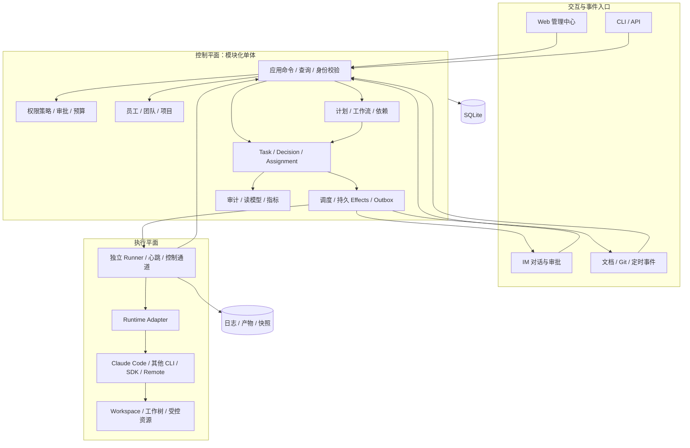
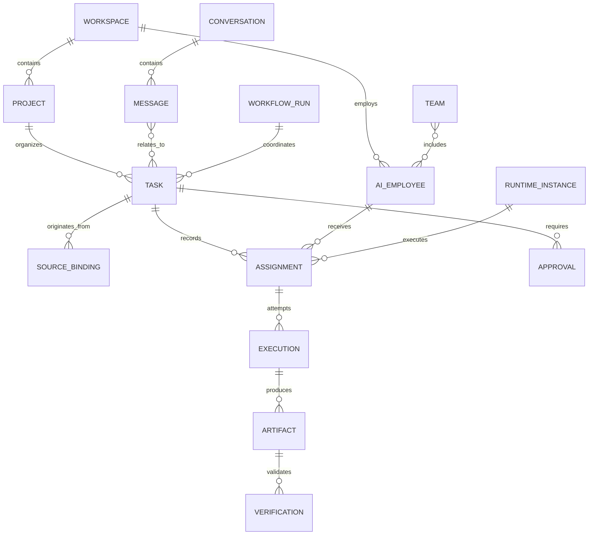
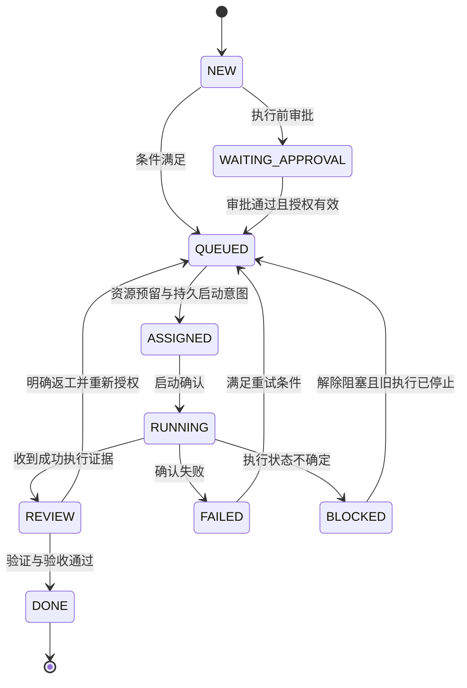

# AI Workforce OS 架构设计与实施蓝图

> 基线说明：本文从原 LAO 工作区迁入，描述目标架构及迁移时旧仓库的技术现状。新项目当前交付范围、命令名与验收结果以 [B0 交付记录](BOOTSTRAP.md) 为准；新增技术尚未全部安装。

版本：0.1 · 日期：2026-11-04 · 状态：架构设计提案，供产品与工程评审。

适用范围：从当前 DSH SuperAgent Fork 迁移出的 LAO 本地内核，演进到完整 AI 员工组织管理平台。本文中的接口、表结构、目录和 API 除明确列为“已实现”外，均为目标设计，不代表当前可用能力。

依据：产品负责人提供的 `MASTER_PRD.md`、`PRODUCT_UX_SPEC.md`（均为 1.0），以及当前仓库的 Core、SQLite、Executor 和阶段记录。本文不替代产品蓝图；实现范围变化应同时更新产品需求、架构决策和验收记录。

## 阅读导航

- 产品负责人：第 1–4、15、19–23 节，了解产品范围、交付路径与待决策事项。
- 后端与 Runtime 工程师：第 5–14、16–18 节，了解领域、协议、一致性和执行安全。
- 前端与体验设计：第 5、7、14–15 节，了解业务对象、状态和页面数据契约。
- 测试与运维：第 9–13、17–21 节，了解故障边界、恢复和发布门禁。

## 1. 架构结论

AI Workforce OS 是面向人的 AI 员工组织与工作管理平台。LAO 是其本地调度、执行管理与持久化内核。两者采用同一套领域语言，逐步扩展，避免形成互不兼容的两个产品。

推荐先采用 **模块化单体控制平面 + 独立 Runner 执行进程 + 适配器集成边界**：控制平面统一处理业务命令、权限、任务和审计；Runner 管理实际 Runtime 进程；外部 IM、文档、代码平台通过适配器连接。

第一版运行在本机，以 SQLite 为事实来源，默认单员工、单执行并发。通过一个真实工作闭环验证可靠性，再交付可操作的 Web 管理中心与多员工协作。保留本地优先部署；远程 Runner、多用户和服务端部署按明确需求扩展。

### 1.1 必须始终成立的约束

1. AI Employee、Runtime、Model、Skill、Workspace 分开建模。
2. 外部 Issue/消息是工作来源；内部 Task 是工作主记录。
3. Agent 可以提出建议；权限、状态迁移、审批和最终完成由系统校验。
4. 每个副作用有执行身份、授权范围、限时和可追溯结果。
5. 未确认旧执行已经停止，禁止启动同一任务的新执行。
6. 成功必须同时考虑执行证据、验证证据和审批策略。
7. UI、IM、CLI 使用相同应用命令，不能各自实现状态和授权规则。
8. Core 与任何模型供应商、Agent Runtime 和 IM 平台无直接依赖。

## 2. 产品范围与版本策略

| 层次 | 产品目标 | 当前优先交付 | 后续扩展 |
| --- | --- | --- | --- |
| 人与组织 | 管理 AI 员工、团队、岗位和负责人 | 一个 Owner、一个配置化员工、一个项目 | 多员工、团队、部门、协作权限 |
| 工作管理 | 多来源 Task、计划、依赖、交付物 | 钉钉 Issue → Ticket → Assignment → Execution | 子任务、工作流、项目计划 |
| 沟通 | IM 发起工作、对话、审批和交付 | 钉钉文档接入与状态回写 | 群聊、@员工、会话、多平台 |
| Runtime | 统一管理 CLI/SDK/API/Remote | 本地 Claude Code 适配 | 其他 Runtime、远程节点 |
| 治理 | 权限、审批、审计、紧急停止 | 本地 Owner、执行前审批、交付审核 | 精细资源授权、多人审批、预算 |
| 产品体验 | 完整 Web、IM、CLI/API | 首先 CLI 闭环，再交付核心 Web 操作 | 完整 UX 导航与跨模块关联 |
| 知识与运营 | 知识积累、质量和成本分析 | 记录产物、验证、人工决策和可用用量 | 知识发布、搜索、绩效分析 |

CLI 是技术闭环的第一交付界面。AI Workforce OS 的完整产品验收仍包含 Web 与 IM，不因首版采用 CLI 而取消。尚未实现的页面可以在阶段版隐藏，完整产品必须逐项满足 UX 文档；不以静态菜单或空统计卡片作为完成依据。

## 3. 总体逻辑架构



图中的控制平面模块是代码和所有权边界，第一阶段不拆成多个网络服务。Runner 是独立进程边界，因为它需要在控制平面重启时继续记录执行，而非因为需要微服务。

控制平面拥有业务数据库写权限。Runner 只写自己的私有运行目录和事件日志，通过受控通道报告；Agent Runtime 不获得业务数据库、审批凭证或管理 API 的通用凭证。

## 4. 技术与部署决策

具体组件建议、保留/替换清单与引入阶段见 [技术栈建议](TECH_STACK.md)。其中新增框架仍是选型提案，当前未安装。

| 领域 | 决策 | 理由与演进条件 |
| --- | --- | --- |
| 后端 | TypeScript、项目支持的 Node 版本 | 复用现有领域与事务实现 |
| 架构 | 模块化单体，依赖倒置 | 本地运维简单；只有隔离与扩容需求明确后再拆服务 |
| 主存储 | SQLite WAL、事务、版本化迁移 | 保留当前基础；多节点并发写入或高可用要求出现时评估服务端数据库 |
| 消息与队列 | 数据库 Effects、Outbox、持久 Inbox | 不引入 Redis 作为首版必需组件 |
| 文件存储 | 私有本地目录 + 数据库元信息 | 日志和大产物不塞入 Task JSON |
| API | HTTP JSON 命令/查询，SSE 状态事件 | 首版实时通信以单向更新为主；未来有双向高频需求再评估其他协议 |
| Web | 独立 React + TypeScript 应用，移除宿主注入机制 | 保留团队熟悉的前端语言；路由与组件库实施时单独决策 |
| 进程管理 | 独立 Runner、受控 IPC、原子元信息文件 | 支持监控恢复、终止确认和日志续读 |
| 本机服务 | 前台运行优先，再封装操作系统服务 | 首版不强制 Docker；可按平台提供服务安装和卸载 |
| AI 判断 | 规则为必需能力，ModelProvider 为可选扩展 | 无模型也能入队、授权和调度；模型不可替代权限规则 |

本地默认绑定 loopback。访问控制不能依靠“只在 localhost”：HTTP 使用本机管理凭证、来源校验及必要的 CSRF 防护；CLI 优先本机私有 socket。若开放局域网/公网，必须进入独立部署配置，启用 TLS、身份认证、资源授权与凭证轮换。

## 5. 领域模型与术语

### 5.1 概念及所有权

| 对象 | 含义 | 核心边界 |
| --- | --- | --- |
| Organization | 组织身份与治理范围 | 后续多组织隔离，不能等同外部钉钉组织 ID |
| Workspace | 产品工作区 | 管理成员、项目、员工和集成；区别于磁盘执行目录 |
| Project | 业务项目 | 绑定仓库、知识、团队及交付规则 |
| AI Employee | 持久员工身份 | 岗位、职责、能力、策略；不等同一个进程 |
| Team / Department | 协作和组织结构 | 团队可先实现，部门层级按需要增加 |
| RuntimeDefinition | Runtime 类型与协议 | 定义驱动和能力，例如 Claude Code CLI |
| RuntimeInstance | 可使用的运行实例 | 主机、版本、凭证引用、健康和并发 |
| RuntimeSession | Runtime 会话引用 | 可能跨执行，也可能不支持恢复；不承载业务最终状态 |
| SkillBinding | 员工绑定的技能与版本 | 明确来源、启用状态和授权；不能自动扩大员工权限 |
| Task / Ticket | 工作聚合 | 产品称 Task；迁移期内部保留 Ticket，实现一个主记录 |
| Assignment | 一次工作分配 | 固定员工、Runtime、策略和输入版本；重分配创建新记录 |
| Execution | 一次实际启动尝试 | PID/Runner、会话、日志、结果与时间；每次新启动使用新 ID |
| Artifact | 可交付证据 | 代码快照、文件、报告、链接；有内容哈希和访问范围 |
| Verification | 质量验证记录 | 绑定 Execution 与产物版本；不能由自然语言总结代替 |
| Approval | 有范围的人工授权/验收 | 绑定动作、资源、版本、有效期和审批人 |
| Trigger / Thread / Eval / Decision | 来源、上下文与判断链 | 保留原有成熟领域，记录为何产生工作与依据 |
| Conversation / Message | 人与员工沟通 | 可关联多个任务；消息不必都转换成任务 |
| WorkflowDefinition / Run | 协作计划及其一次运行 | 发布版本不可变；运行固定版本 |

AI Manager 是一个有协调职责的 AI Employee，使用受限的“提议计划/请求分配”能力。系统仍需校验所提议的员工、依赖、权限、预算和子任务数量。

### 5.2 聚合关系



当前实现的单 Issue → 单 Ticket 约束继续适用于首版。以后支持一个 Task 关联多条来源时，以独立 SourceBinding 迁移，禁止复制 Task 内容制造多个事实来源。

### 5.3 必须固定的执行快照

Assignment 固定：员工配置版本、Runtime 实例及能力版本、Task 输入版本、Policy 版本、Skill 清单版本、Workspace 范围、基础代码版本和预算。执行期间修改员工配置只作用于后续分配；当前分配若需变更，明确撤销、停止或重新授权。

## 6. 模块与依赖边界

| 模块 | 负责 | 禁止承担 |
| --- | --- | --- |
| Core / Work | Task、领域状态机、Decision、Assignment、审核规则 | spawn CLI、HTTP 请求、读取凭证 |
| Workforce | 员工身份、能力、团队关系、启停与版本 | 把 Runtime 进程当员工状态全部依据 |
| Orchestration | 调度、资源占用、重试、恢复、工作流推进 | 绕过 Engine 直接改终态 |
| Runtime | 适配协议、能力探测、执行控制、结果归一 | 决定 Task 完成、权限扩大 |
| Communication | 身份映射、会话、消息路由、渠道回执 | 信任昵称、接受未校验的审批文本 |
| Integration | 外部连接、Source codec、分页、同步状态 | 在调度器中散布 dws/gh 命令 |
| Governance | 认证、授权、审批、策略、预算、审计 | 接受 Agent 自报审批通过 |
| Knowledge | 知识条目、来源、版本、检索权限 | 将所有 Runtime 日志自动当可信知识 |
| Analytics | 从事件与事实生成指标 | 回写任务状态或以缺失用量当零成本 |
| Storage | Repository、迁移、索引、事务 | 导入宿主、模型或 Runtime 包 |

依赖方向：入口 → 应用服务 → Core 与端口；Storage、Source、Runtime 实现端口，由 composition root 注入。模块间通过显式接口调用或持久事件协作，禁止任意读写其他模块表。

## 7. 状态设计

### 7.1 Task 状态与产品展示

首版保留当前已实现状态，不仅为匹配 UI 重命名数据库值。展示文案可以本地化，业务含义必须稳定。

| 内部状态 | 产品展示 | 进入条件 | 主要后续方向 |
| --- | --- | --- | --- |
| NEW | 新请求 / Inbox | 来源被接受，建立任务 | QUEUED、WAITING_APPROVAL、BLOCKED、CANCELLED |
| QUEUED | 待执行 / Pending | 已具备调度授权，等待资源 | ASSIGNED 或因条件变化转阻塞/审批/取消 |
| ASSIGNED | 已分配 | 分配和启动意图已持久化 | RUNNING、FAILED、BLOCKED、CANCELLED |
| RUNNING | 执行中 | Runner 确认实际启动 | REVIEW、FAILED、BLOCKED、CANCELLED |
| REVIEW | 待验证与验收 | 合法结构化执行结果成功 | DONE；返工/阻塞/取消 |
| WAITING_APPROVAL | 等待执行审批 | 启动前策略要求人授权 | QUEUED、BLOCKED、CANCELLED |
| BLOCKED | 需要介入 | 输入、资源、权限或进程身份不确定 | 条件解除后经命令回到允许状态 |
| FAILED | 执行失败 | 已确认失败且不会继续写入 | 符合重试策略后 QUEUED，或阻塞/取消 |
| DONE | 已完成 / Completed | 验证要求与审核策略已满足 | 首版终态 |
| CANCELLED | 已取消 | 已取消未启动任务，或确认活动执行停止 | 首版终态 |

UX 文档的 Planned 作为后续“已确认计划但未释放执行”的独立业务状态引入，需迁移和独立验收；首版不把它随意映射成 QUEUED。UX 应补充 REVIEW 展示，避免执行结束后直接显示 Completed。



图只展示主路径，完整允许转换以 Core 状态转换表与测试为准。取消是独立命令：活动执行存在时先记录 `cancelRequested` 并停止进程，确认后才进入 CANCELLED。

### 7.2 不同对象分别记录状态

- Assignment：预留、启动中、活动、已结束；记录结束原因。
- Execution：STARTING、RUNNING、STOPPING、SUCCEEDED、FAILED、TIMED_OUT、CANCELLED、UNKNOWN。
- Verification：PENDING、RUNNING、PASSED、FAILED、NOT_REQUIRED；跳过验证需要有权主体和理由。
- Approval：PENDING、APPROVED、REJECTED、CHANGES_REQUESTED、EXPIRED、CANCELLED。
- Delivery：PENDING、SENDING、DELIVERED、FAILED、UNKNOWN。

这些是目标状态契约。当前 Executor 的进程内状态较少，需要在 Runner 阶段补齐，不能称为已实现。

员工状态拆为“启用状态、Runtime 连接健康、活动负载”三个事实，再生成 Online/Busy/Idle/Degraded/Offline/Disabled 展示；不以一列覆盖所有含义。

### 7.3 完成判定

`可完成 = 当前执行身份匹配 ∧ 执行成功 ∧ 产物版本匹配 ∧ 验证通过或经授权豁免 ∧ 审核策略满足 ∧ 无撤销/取消冲突`。

第一版统一进入 REVIEW，并经显式验收命令结束。未来允许低风险自动验收时，必须有独立、版本化的完成策略，审核主体记为系统策略，不能伪装人工批准。

## 8. 调度与多员工协作

### 8.1 首版调度算法

1. 过滤：QUEUED、未取消、来源未关闭、依赖满足、授权有效、到达运行时间、预算允许。
2. 路由：Task 类型 → 员工能力 → 项目/资源授权 → Runtime 能力与健康。
3. 排序：优先级降序、进入队列时间升序、ID 稳定排序；后续增加等待时间加权，防止低优先级长期饥饿。
4. 占位：在短事务内检查 Task version 和容量，创建 Assignment、资源占用、launch Effect。
5. 启动：事务外准备工作目录并请求 Runner，持久记录启动回执。
6. 运行：消费心跳与有序事件，更新投影和超时。
7. 结束：提交执行证据、释放确认结束的资源，进入验证与交付流程。

允许并发取系统、员工、Runtime 实例、项目配置的共同限制。编码类任务每次执行持有独占目录；同一 Task 不能因轮询或重试产生重叠写入。第一版默认系统并发 1，不启用“人的后续输入额外占一槽”的原规则。

### 8.2 后续工作流

采用发布后不可变的 WorkflowDefinition，WorkflowRun 固定其版本。最初支持 DAG：Agent Task、Verification、Approval、Condition、Join 五类节点；循环与动态图按后续专门设计处理。

AI Manager 提交 PlanProposal；系统检查循环依赖、资源范围、最大子任务数、并行上限、预算和审批需求后，才生成正式子任务。每个节点使用自身 Task/Assignment/Execution 记录，不共享可写代码目录。

并行开发结果在独立集成任务中合并，冲突由指定员工或人处理。审查员工使用产物快照进行审查，不直接修改作者执行目录；父任务完成要求必需子任务、汇总验证和最终验收全部满足。

## 9. 执行协议与独立 Runner

### 9.1 Runtime 能力声明

目标能力契约应包含：start、stop、结构化输出、用量、活动输入、会话续接、监控重连、暂停、隔离等级、工具授权控制。能力既有驱动声明，也有具体实例的已验证结果。

```ts
// 目标接口示意；不表示当前 Executor 已提供这些能力。
interface RuntimeCapabilities {
  activeInput: boolean
  continueSession: boolean
  reattachMonitor: boolean
  pause: boolean
  structuredResult: boolean
  usageReporting: boolean
  enforceableToolPolicy: boolean
}
```

`continueSession` 是在确认旧执行结束后，使用 Runtime 会话创建新 Execution；`reattachMonitor` 是重新观察同一个活动 Execution。两者不能统称为 resume 并模拟成功。UI 只显示实例已验证的可用能力。

### 9.2 启动契约

LaunchSpec 包含 executionId、assignmentId、generation、员工/策略快照引用、cwd、输入快照、超时、日志限额、允许环境变量、凭证引用、允许操作和预算。敏感值不进入 Ticket、命令行参数、事件或普通日志。

当前 Claude 适配器所用 CLI 版本与参数以阶段检查记录为依据；本文不发明新的 CLI flag。真实运行协议必须完成受控 smoke，缺失的能力返回 unsupported，无法强制执行的权限不得宣称已受控。

### 9.3 Runner 所有权与事件

- 一个 Runner 管理一个 Execution。启动前创建私有执行目录，记录不可重复的 launch token 和执行身份。
- Runner 在启动 Runtime 前持久化“已接受启动”记录；同一 executionId 的重复请求返回现有状态，拒绝不同参数覆盖。
- Runner 元信息包含 PID、进程创建时间、Runner 身份、主机实例 ID、工作目录、Runtime session 和 launch token 指纹；PID 单独不足以证明进程身份。
- 本机私有 IPC 控制通道校验所有权与随机控制凭证；事件采用递增序号，写入日志后才能上报。
- 控制平面通过 `(execution_id, sequence)` 去重；断线后从最后已持久序号续读。
- Runner 事件记录实际 exit code、signal、超时/取消原因、起止时间和协议校验结果。收到“进程退出”后仍需等待输出流关闭与日志落盘。
- 控制平面停机时，Runner 能继续记录；机器重启后依赖持久记录进行对账，不承诺本地子进程跨机器重启存活。

### 9.4 文件与产物隔离

目标路径按 `project/task/assignment/execution` 分层，避免重试目录同名。Worktree 固定基础 commit、归属 marker 和独占占用；日志存放在工作树外。

Worktree 提供代码目录隔离，**不提供操作系统安全沙箱**。运行时同用户的其他文件、网络和凭证访问，需要 Runtime 自带的有效权限机制或额外 OS/容器边界；限制 cwd 和写 prompt 都不足以实现强隔离。

产物完成时生成不可变快照及 manifest：基础 commit、tracked diff、untracked 文件内容哈希、文件权限/链接元信息、验证记录和总哈希。明确忽略规则、文件数/大小上限、symlink 处理及路径逃逸检查。收集失败标为证据不完整，不能用通用占位 revision 继续验收。

当前 Executor 已有 commit+diff/未跟踪内容指纹雏形；它不是完整不可变 Artifact 服务，也尚未覆盖上述边界。

## 10. 一致性、幂等与恢复

### 10.1 事务与副作用

同一 SQLite 事务提交 Task 变更、Assignment、审计和 launch/stop/writeback Effect。事务内不启动进程、不调用 CLI、不访问外网。消费者在提交之后执行副作用，再通过幂等应用命令提交回执。

系统采用“至少一次投递 + 幂等消费 + 状态对账”，不宣称跨数据库、进程和钉钉的 exactly-once。

| 幂等层 | 唯一键/条件 | 作用 |
| --- | --- | --- |
| 来源事件 | connectionId + 外部 eventId，或 resourceId + 外部 revision | 重复事件不重复处理 |
| 来源绑定 | workspaceId + connectionId + sourceType + resourceId | 不同组织或连接的同号 Issue 不碰撞 |
| 业务命令 | workspaceId + commandType + idempotencyKey | HTTP/IM 重试不重复创建或审批 |
| 调度 | taskId + 当前 version + 活动 Assignment 约束 | 防止重复分配 |
| 启动 | executionId + launch token + generation | 重复启动请求不重复 spawn |
| Runner 事件 | executionId + sequence | 重放不重复应用 |
| 回写 | bindingId + taskVersion + deliveryType | 同一版本回写可追踪 |

### 10.2 锁、租约与防旧回调

本地控制平面持有单实例锁；Assignment 与资源占用仍落库，支持恢复对账。generation 单调递增，旧 Runner 回调不能覆盖新分配。Task version 用于乐观并发，冲突返回当前版本供调用方刷新。

租约过期只说明失去联系，不说明 Runtime 已停止。发现活动身份不确定时保留占用、进入 BLOCKED/UNKNOWN，并执行对账；远程扩展也必须遵守这一点。

### 10.3 重启恢复矩阵

| 持久状态与证据 | 动作 | 禁止动作 |
| --- | --- | --- |
| 启动意图存在，Runner 未知 | 用同 executionId 查询/握手；判断是否接受过启动 | 分配新 ID 后盲目再跑 |
| Runner 存活且身份匹配 | 续读序号事件并恢复观察 | 仅凭 PID 相同就信任 |
| Runner 已退出，有完整终态与产物 | 幂等收集并推进到 REVIEW/FAILED | 再次执行来“补结果” |
| Runtime 活着但 Runner 不可连接 | 保留占用并阻塞；人工或受控终止 | 自动结束 Assignment 并释放目录 |
| 进程已确认不存在，存在可续会话 | 根据能力、策略和授权创建新的恢复 Execution | 把续会话伪装成原进程仍运行 |
| 进程不存在且证据不完整 | 标记中断，确认目录状态，再决定重试 | 标为 DONE |
| 远端回写结果 UNKNOWN | 先回读目标并比对 delivery 标记 | 无条件重复追加评论 |

### 10.4 重试分类

瞬时且确定未生效的读取错误可退避重试；授权/配置错误进入 BLOCKED；执行超时必须先确认整个受管进程组停止；启动结果未知先对账；代码任务失败按策略和次数上限重试，保留每次 Assignment 与 Execution。

同一执行恢复观察不增加尝试次数；新执行计入执行预算。人工重试仍需权限、理由和上限检查；超上限不是简单清零，需显式策略变更并留下审计。

## 11. 钉钉与 IM 集成

### 11.1 连接、来源、渠道分开

IntegrationConnection 管认证引用、外部组织和健康；SourceBinding 管 Issue/文档映射；ChannelBinding 管群聊/会话与员工/团队的关联。使用同一钉钉账号不意味着这三者具有相同授权范围。

外部用户身份使用平台稳定 userId + 外部组织 + connectionId 映射内部 Principal。群名称、显示名和消息正文不能作为授权身份。消息来源真实性由实际连接机制校验，不能只相信 payload 中的 actor 字段。

### 11.2 文档轮询闭环

1. 从配置范围分页读取 Issue，保留 complete/hasMore/cursor/失败项等真实结果。
2. 标准化字段与来源版本；无法解析的条目隔离为接入错误，不猜默认状态为可执行。
3. 事务去重，创建 Trigger、来源快照和 Task，规则 Assessor 判断接收/审批。
4. 已存在条目按 revision 比较；扫描未出现不等同已删除/关闭，尤其不能在分页失败时批量取消。
5. 活动 Task 的描述变化记录新快照并提示；不静默替换执行输入，必要时请求新授权。
6. 已关闭来源不启动；运行中关闭时按配置提出取消，确认停止后更新内部状态。
7. DONE/CANCELLED 首版保持终态；来源重新打开需显式请求后续工作并建立关联，不因更新时间变化自动重跑。
8. 状态/结果经 Outbox 回写，保留外部回执及回读验证。

扫描游标只有在该批记录已持久处理后才推进。轮询重叠需互斥，支持取消、超时、速率限制和退避。默认三分钟是配置默认值，不是 CLI 参数。

### 11.3 状态映射与回写

状态标签、字段位置和结果存放方式由 Source codec 配置并校验；内部状态不依赖钉钉中文文案。回写只更新配置允许的字段或 LAO 管理区，避免覆盖人的正文。

回写由“状态更新”和“结果摘要/产物链接”组成；内容附可识别 deliveryId/版本标记，平台若不支持稳定标记或幂等键，则 UNKNOWN 需要回读与人工处理。内部任务完成与外部交付状态独立，钉钉临时失败不能触发重新执行代码。

已核验本机 DWS 存在文档 list/search/fetch/update/comment 能力，但实际 Issue 文档字段和写入位置尚未确定。需真实样例或产品方接受一份拟定 Issue 模板，才可落实 codec；模板提案不能被称为已经核验的接口。

### 11.4 IM 原生工作流

消息 → 身份/渠道校验 → Conversation 上下文 → 明确命令或意图建议 → 授权 → Task/查询/审批 → 回复。对于模糊意图，可生成 Task 草稿或澄清请求；规则或模型理解不能直接产生高风险授权。

补充指令若 Runtime 不支持活动输入，则入库为待处理消息，并让用户选择下次执行/新任务；不能显示“已送达 Agent”。Agent 间协作使用内部事件与任务交接，IM 负责对人的沟通。

## 12. 权限、审批与预算

### 12.1 授权模型

采用角色授权 + 资源范围 + 动作约束：主体（人/员工/系统服务）对 Workspace、Project、Task、文件、命令或集成资源执行动作。组织和员工策略组合时取允许范围交集，显式禁止优先。

运行权限有效范围：组织策略 ∩ 项目策略 ∩ 员工授权 ∩ Task Mandate ∩ Runtime 可强制执行能力 ∩ 当前审批。

审批对象固定：请求主体、具体动作、资源、参数摘要/哈希、Task/Assignment/Execution、产物 revision、Policy version、有效期和是否单次使用。执行前重新核验；产物或参数变化使旧审批失效。AI Manager 不得批准自身提案或提高员工权限。

### 12.2 高风险操作的执行边界

Push、合并、发布、删除外部数据原则上交给独立 ActionExecutor 执行：Agent 生成变更与请求，系统展示影响范围，人批准后由最小权限集成适配器执行并校验结果。

只有当 Runtime 能实际禁止等价操作时，才能宣称高风险动作受到强制审批。任意 Shell + 同用户环境允许绕过简单命令名单；必须限制工具与凭证、采用有效隔离，或禁止此类自动运行并转为人工执行。prompt 中的禁止文字仅是工作指令。

### 12.3 凭证与技能

凭证值由系统安全配置/操作系统凭证库提供，业务表仅存 secretRef。不同 Runtime 可用本机登录或显式凭证注入，通过驱动声明配置；不要全局继承所有环境变量，也不要永久写死屏蔽全部 API key 的产品策略。

Skills 有版本、来源、内容指纹、启用审批和资源访问说明。技能、Issue、检索知识与仓库指令均视为不可信输入；任何指令都不能改变平台授权。

### 12.4 预算与紧急停止

预算至少包含时长、并发、重试次数、输出大小、工作流节点数和可用模型用量。已知费用可以设预估和限额，Runtime 不提供费用时显示未知。不能以未知费用承诺精确成本控制。

紧急停止：持久化全局禁止新分配 → 取消待启动意图 → 请求活动 Runner 停止 → 对账终止结果 → 记录未停止实例并告警。紧急停止本身需要授权和审计，不能只修改前端按钮状态。

## 13. 数据存储与迁移

### 13.1 存储分层

SQLite 保存可查询业务事实、唯一约束和审计；文件系统保存日志、事件段、输入快照、产物与附件。文件先在临时路径落盘、校验哈希、原子提交 manifest，再在数据库登记引用；定期检测未引用文件和失效引用，避免跨存储不一致。

当前 Ticket JSON 聚合继续保留。Assignment/Execution 等查询投影按需建立，明确聚合是事实来源还是独立表是事实来源，禁止无事务的双写。推荐先把 Execution 独立为事实记录，Assignment 迁移使用版本号、双读核对、一次性切换；不在一次重构中重写全部存储。

### 13.2 目标数据族

| 数据族 | 主要实体 | 约束/索引 |
| --- | --- | --- |
| 身份组织 | organization、workspace、principal、membership、team、employee | 稳定 ID、workspace 归属、配置 version |
| 项目资源 | project、repository_binding、execution_workspace | 项目归属、目录所有权、独占占用 |
| 工作领域 | ticket、trigger、thread、decision、source_binding | 来源复合唯一键、状态/优先级/排队时间 |
| 执行领域 | assignment、execution、runner_event、resource_reservation | 活动分配约束、execution+sequence 唯一、generation |
| 交付质量 | artifact、verification、approval、action_request | 内容哈希、审批参数版本、有效期 |
| 集成沟通 | connection、channel_binding、conversation、message、delivery | 外部 ID 与连接组合键、消息去重 |
| 调度基础 | effect、inbox_event、outbox、poll_checkpoint | due/priority、幂等键、重试次数、UNKNOWN 状态 |
| 协作自动化 | workflow_definition、workflow_run、node_run、automation | 发布版本、节点唯一执行键 |
| 审计运营 | audit_event、usage_record、metric_projection | 关联 ID、时间、actor、策略版本 |
| 知识 | knowledge_item、knowledge_version、knowledge_binding | 来源、内容版本、权限范围 |

这是目标逻辑数据模型，不要求首版建齐所有表。已有 `source_issue` 仅按 source/issue_id 唯一；多连接/多组织前必须迁移到有范围的键，不能直接将当前键当成全产品契约。

### 13.3 事件契约

领域事件至少包含 eventId、eventType、schemaVersion、workspaceId、aggregateId、aggregateVersion、occurredAt、actor、correlationId、causationId 和 payload。外部数据保留必要快照，脱敏并受保留策略约束。

使用“当前状态 + 追加审计 + 可重建读模型”，第一版不采用完整 Event Sourcing。审计用于追溯，不承诺仅从当前审计能重建全部业务数据；本机追加表也不等于可防管理员篡改的合规存证。

### 13.4 迁移与备份

每次 schema 迁移有版本、校验、备份和中断恢复说明；重大表切换先在副本演练。使用 SQLite 一致性备份机制，不直接复制正在写入的主文件而忽略 WAL。备份包含产物 manifest，凭证独立恢复。

首版单 Workspace 可以默认创建，但新增持久对象即带 workspace 范围。真正多用户隔离还需应用授权、查询范围、文件访问和恢复测试全部覆盖，不能仅靠加一列宣称完成。

## 14. 应用接口与配置契约

### 14.1 命令/查询约定

应用命令携带 actor、workspace、requestId、idempotencyKey、expectedVersion；actor 来自认证上下文，禁止客户端任意指定有效审批身份。返回对象 ID、version、接受状态和可追踪 operationId；耗时命令返回接受回执，完成另查状态。

目标 API 示例（尚未实现）：

| 接口 | 用途 |
| --- | --- |
| `POST /api/v1/tasks` | 创建任务，CLI/IM 复用同一应用服务 |
| `GET /api/v1/tasks` | 状态、员工、项目、来源筛选，游标分页 |
| `GET /api/v1/tasks/:id` | 任务详情、可用动作与 version |
| `POST /api/v1/tasks/:id/commands` | assign/retry/cancel/request-review 等白名单命令 |
| `GET /api/v1/executions/:id` | 执行状态、能力、产物和日志引用 |
| `POST /api/v1/executions/:id/commands` | stop/deliver/continue，逐项检查能力与权限 |
| `POST /api/v1/approvals/:id/decisions` | 带版本的审批决定 |
| `GET /api/v1/employees` | 员工与运行负载 |
| `GET /api/v1/events` | SSE 事件流，支持恢复游标 |
| `GET /health/live`、`GET /health/ready` | 进程存活与接收工作能力 |

错误使用稳定 code：VERSION_CONFLICT、FORBIDDEN、CAPABILITY_UNSUPPORTED、EXECUTION_UNCERTAIN、APPROVAL_STALE、SOURCE_UNAVAILABLE 等。SSE 断线恢复超过保留范围时要求重新查询，不静默跳过事件。通知内容按订阅者权限过滤。

CLI 保留 `lao init/doctor/start/stop/status/tickets/retry/logs`，补充 approve/reject/cancel/create；具体语法由 CLI 实施记录确定。后续产品品牌可增加统一入口别名，内部身份和数据库不依赖命令名。

### 14.2 配置分离

- 文件：部署地址、数据目录、轮询与并发默认值、Runtime 驱动位置、日志保留。
- 数据库：员工/项目/连接绑定、策略版本、审批规则和工作流。
- Secret store/环境注入：认证值；配置仅引用凭证。
- 执行快照：启动时解析后的非敏感有效配置，不随运行中配置热更新漂移。

配置包含 schemaVersion，严格校验未知危险参数和路径。公开配置示例不得写未经核验的 Claude/DWS 参数；驱动将标准配置翻译为已探测版本支持的真实 argv。

## 15. Web 与 UX 落地架构

Web 展示应用层读模型，通过命令接口完成操作。右侧详情面板与独立详情页使用同一资源 ID；Task、员工、执行、审批、消息、产物可双向跳转。

| UX 页面组 | 主要数据 | 首次上线的真实操作 | 交付阶段 |
| --- | --- | --- | --- |
| Overview / Inbox | 任务、审批、告警投影 | 查看关联事项、处理审批/阻塞 | R1 |
| AI Employees / Runtime | 员工配置、能力、实例健康 | 配置员工、启停、健康检查 | R1 |
| Tasks / Executions | Task 聚合、执行与产物 | 创建、重试、取消、查看日志与验收 | R1 |
| Approvals / Monitoring | 审批、审计、资源状态 | 批准/拒绝、紧急停止、诊断 | R1 |
| Organization / Teams / Projects | 组织与项目关系 | 创建、绑定、调整成员与范围 | R2 |
| Workflows / Automations | 发布版本、节点、触发器 | 发布、运行、暂停、观察失败节点 | R2 |
| Conversations / IM Channels / Notifications | 消息、身份、渠道 | 绑定员工/团队、任务关联、查询与反馈 | R1 基础，R2 完整 |
| Knowledge / Analytics | 知识条目、质量与用量投影 | 搜索、发布知识、指标钻取 | R3 |
| Integrations / Permissions / Settings | 连接、角色、配置版本 | 健康检查、授权调整、保留策略 | R1 基础，R2 完整 |

所有已上线页面必须有加载、空、失败、无权限、操作中和冲突状态。按钮可用性取决于权限、对象当前状态和 Runtime 能力；后端始终复验。员工“暂停接单”与执行“暂停进程”采用不同文案。

采用 UX 规格更细的分组导航作为信息架构，PRD 的各 Center 映射为功能域。默认深色、提供浅色，状态同时显示文字与图标。移动端优先任务、通知和审批；复杂工作流编辑以桌面端为主。

## 16. 知识、记忆与绩效

工作上下文分三层：执行临时上下文、任务历史、正式组织知识。Runtime 会话是临时上下文来源，不能作为唯一持久记忆；任务历史保存事实；正式知识经选择、脱敏和审核后发布，并保留来源/版本/权限。

第一步对任务标题、说明、产物与知识元信息做权限过滤搜索；语义检索按实际需要增加，不先引入向量数据库。检索内容仍是不可信业务数据，引用来源不能授予工具权限。

指标由事实记录计算，定义口径而非只展示数字：

- 任务交付成功率：同一统计窗口内进入终态且完成验收的任务 / 纳入口径的终态任务；取消单独列出。
- 执行失败率：失败 Execution / 已终结 Execution，与 Task 成功率分开。
- 交付耗时：接收→验收，可拆队列、执行、验证、人工等待和外部交付。
- 返工率、人工介入率、审批通过率：记录事件类型及分母，按任务复杂度/项目维度分析。
- Token/费用：仅在 Runtime 提供且字段定义已确认时聚合；未知保留 null，模型费用与平台费用分开。

## 17. 日志、运维与非功能目标

结构化日志包含时间、级别、模块、Task/Assignment/Execution、requestId 和错误 code；敏感信息不进默认日志。stdout/stderr 原始内容也可能有业务敏感数据，设置文件权限、访问审计和保留上限；脱敏正则不能被视为完整安全保障。

健康分别展示：控制平面、数据库、Runner、Runtime 认证、Source 权限、回写、磁盘容量和队列。readiness 失败可以暂停接单而允许查询与修复。权限失败不在高频轮询中无限重试。

以下是拟定验收目标，需在目标机器实测，不是当前性能承诺：

| 指标 | 本地首版目标/判据 |
| --- | --- |
| 连续运行 | 72 小时混合任务 soak，无遗留孤儿执行和重复分配 |
| 接入时延 | 正常条件下不超过一次轮询间隔加当前扫描时间 |
| 查询体验 | 1 万任务测试集，常用本地列表 API p95 < 500ms，排除 Runtime/外部请求 |
| 重启恢复 | 注入故障后恢复对账在 60 秒内给出运行/终结/阻塞的可信结论 |
| 停止 | 受控 fixture 在配置的优雅期与强杀期内确认结束；失败明确告警 |
| 幂等 | 重复投递、并发命令、崩溃恢复测试中无重复活动执行 |
| 数据恢复 | 已提交业务事务可恢复；备份恢复演练能关联对应产物 manifest |

RPO/RTO 对本地备份与团队部署分别约定。默认每日备份意味着机器损毁可丢失最近一个备份周期的数据，不能因 SQLite 事务持久就承诺机器故障零丢失。

## 18. 目录与代码演进

短期保留现有 `src/core`、`src/storage`、`src/executor`、`src/sources`，增量抽取独立入口，避免为了目录整洁一次搬迁成熟代码。目标分层示意：

```text
src/
  core/                 # 现有 Engine、领域、生命周期、端口
  workforce/            # 员工、能力、团队与配置版本
  projects/             # 项目和资源绑定
  orchestration/        # scheduler、reservations、recovery、workflow
  executor/             # Runtime 驱动与标准协议
  runner/               # 独立 Runner 入口、IPC、日志和进程管理
  sources/dingtalk/     # 真实 CLI transport、Issue codec、poller
  communication/        # conversation、identity mapping、channels
  governance/           # 权限、审批、动作执行、预算
  knowledge/            # 知识条目与检索
  analytics/            # 指标与查询投影
  storage/              # SQLite、Repository、版本迁移
  application/          # composition root、commands、queries
  config/               # 配置 schema 与 secret 引用
  cli/                  # 本地管理入口
  api/                  # HTTP/SSE 入口
web/                    # 独立前端，后续加入
tests/                  # 领域、集成、协议、故障和端到端
docs/                   # 架构、ADR、运行手册和验收证据
```

原 `src/app` 仍有旧宿主，迁移期间不要把新独立组合根误接到旧 Cordis Runtime。独立入口完成后删除旧 DSH adapter、宿主插件入口、patch、依赖与构建注入；保留来源与许可说明。

## 19. 当前代码与目标的差距

| 项目 | 当前证据 | 尚需完成 |
| --- | --- | --- |
| Core | 已建立独立闭包、生命周期和事务门禁 | 应用身份、完整调度与多连接范围 |
| SQLite | 已抽取 Repository、来源绑定和审核/重试审计 | Execution/Artifact/Runner 持久化与范围化索引 |
| Claude Executor | 有接口、Worktree、进程监控与 mock 测试 | 真实协议 smoke、失败路径覆盖、准确退出原因、可靠终止与日志、产物快照 |
| Runner 恢复 | 当前适配器明确不支持重启重连 | 独立 Runner、IPC、持久事件、身份核验与故障演练 |
| 钉钉 | CLI 能力检查与 Adapter 类型 | Issue codec、真实分页、状态映射、回写校验、幂等投递 |
| 权限 | Core 有版本检查和审批审计 | 可信 actor、工具/资源强制边界、ActionExecutor 和失效审批 |
| 独立产品 | 仍保留旧宿主入口与 DSH 包 | standalone daemon/CLI、包与锁文件清理 |
| 产品功能域 | 已有领域基础，不代表 Workforce OS 完成 | 员工管理、IM 会话、Web、多员工、工作流、知识与分析 |

此前 Phase 2 的“代码里程碑”不能等同于“Runtime 验收通过”：目前只有模拟协议集成测试。后续实施先补齐失败、超时、输出超限、启动竞态和恢复门禁，再扩大产品面。

## 20. 交付路线、依赖和验收

原 Phase 0–5 是 LAO 技术改造阶段。以下 R0–R3 是产品发布里程碑，两者不替代、不混淆。先完成基础门禁再扩展。

| 发布里程碑 | 工作包 | 前置条件 | 验收证据 |
| --- | --- | --- | --- |
| R0-A：可靠执行底座 | Executor 故障路径、独立 Runner、Execution 持久化、隔离/权限边界 | 已有独立 Core | 真实受控 Claude 任务 + 启停/超时/崩溃矩阵通过；能力声明与实际一致 |
| R0-B：首个业务闭环 | 钉钉 codec/poller/Outbox、规则判断、队列、CLI、独立打包 | Issue 真实契约；R0-A | 同一 Issue 重复扫描只创建一个任务；完成→审核→回写有证据 |
| R0-C：本地可运营版 | 审批、重试、恢复、备份、doctor、日志、DSH 清理 | R0-B | 无 DSH 依赖的安装启动；72 小时运行与恢复演练；人工完整验收 |
| R1：可操作管理产品 | 一个工作区、多员工配置、核心 Web、Task/Execution/Approval、钉钉 IM 基础 | R0-C | 用户可创建员工与任务、查看真实执行、验收、重试、取消、管理连接 |
| R2：AI 团队协作版 | 团队/项目、能力路由、工作流 DAG、AI Manager 提案、第二 Runtime、多用户身份 | R1；真实第二驱动验证 | 两类 Runtime 员工协作，依赖/失败/权限/合并/人工节点可追溯 |
| R3：知识与运营版 | 知识发布检索、成本质量分析、自动化、更多 IM、远程 Runner | R2；相应隔离与部署设计 | 有权限的知识检索、可钻取指标、受预算约束的主动任务与远程恢复 |

知识与绩效的原始事实从 R0 开始收集，专门产品界面在 R3 交付。组织、IM 和权限也应在早期形成可扩展 ID 与接口，后续再扩大操作能力。

### 20.1 测试与质量门禁

| 层次 | 必测场景 |
| --- | --- |
| 领域 | 状态转换、重复 Issue、过期授权、旧执行回调、审核绑定产物、取消竞态 |
| 存储 | 事务回滚、唯一约束、并发版本、历史迁移、备份恢复、Effects/Outbox 重放 |
| Runtime 协议 | 真实版本探测、stdout/stderr、无结果/坏 JSON/错误结果、非零退出、Token 缺失 |
| 进程故障 | 启动失败、控制平面崩溃、Runner 崩溃、PID 复用、超时、强杀、停止竞态、输出超限 |
| Source | 分页不完整、字段缺失、关闭/重开、版本更新、连接身份冲突、回写 UNKNOWN |
| 安全 | 身份冒充、跨项目访问、路径/符号链接逃逸、凭证泄露、高风险动作绕过、审批过期 |
| 产品 E2E | 创建→分配→执行→验证→验收→交付，以及失败、取消、人工重试分支 |
| 协作 | DAG 环检测、节点幂等、部分失败、并行修改、审查/集成隔离、预算上限 |

各工作包完成后执行对应 TypeScript、单元、集成、依赖边界和文档检查。真实 CLI 测试与 fixture 测试分开记录。因本机监听/进程权限受限的测试须在适合环境复验，不能用“沙箱原因”替代验收证据。

## 21. 主要风险与控制措施

| 风险 | 影响 | 控制措施 |
| --- | --- | --- |
| 产品面过宽 | UI 和组织功能掩盖执行可靠性缺口 | 以 R0 真实闭环为扩展门槛，分版本验收 |
| CLI 能力漂移 | 参数、输出、认证和权限变化 | 固定已测版本范围，实例 doctor，契约测试与明确 unsupported |
| 子进程启动/回调竞态 | 孤儿执行、状态与真实进程不符 | 独立 Runner、启动意图、事件序号、对账、generation |
| 权限依赖 prompt | Agent 可以越过业务审批 | 工具/凭证最小化、有效隔离、高风险动作独立执行 |
| 远端回写不幂等 | 重复评论或覆盖人工内容 | Outbox、标记、回读；UNKNOWN 不盲重试 |
| 任务来源更新影响活动执行 | 执行旧要求或授权扩大 | 输入版本冻结、记录变更、重新确认范围 |
| 多员工并行改代码 | 冲突、产物来源不明 | 每执行独立目录、不可变快照、专门集成与验证 |
| 历史存储模型迁移 | JSON/关系表双写失真 | 小步迁移、明确事实来源、备份演练和校验 |
| 日志/用量不完整 | 数据泄露、错误成本结论 | 访问与保留控制、脱敏、未知显式展示 |
| 过早远程/多组织化 | 安全与运维复杂度突增 | 先单工作区本地可靠，再按独立 ADR 开放边界 |

## 22. 架构决策记录（ADR 索引）

以下为建议采纳的决策，正式实施时将变化理由、影响和证据拆入独立 ADR。

| ADR | 决策 | 暂不选择 | 重新评估触发条件 |
| --- | --- | --- | --- |
| 001 | 模块化单体 + Runner | 首版微服务 | 独立团队所有权、部署隔离或明确容量需求 |
| 002 | SQLite + 本地文件 | 首版 Redis/服务端数据库必需 | 多节点写入、集中托管、高可用 |
| 003 | Task 与现有 Ticket 同一聚合 | 两套独立任务系统 | 领域职责确实分离且有迁移收益 |
| 004 | Runtime/Employee/Session/Execution 分离 | 一条 Agent 记录代表全部 | 原则性决策，新增驱动只扩展能力 |
| 005 | 状态 + 审计 + Outbox | 完整 Event Sourcing | 确有全量历史重演/时间旅行要求 |
| 006 | 人工授权绑定具体动作与产物 | 永久整 Task 放行 | 新治理需求经风险评审 |
| 007 | IM 外部沟通，内部任务总线协作 | Bot 互聊作为协作基础 | 平台能力变化不改变内部可靠性基础 |
| 008 | Web 建立在同一应用命令上 | 前端直接改数据库或独立状态规则 | 原则性决策 |
| 009 | 模型判断可选 | 云模型作为调度必需依赖 | 产品明确增加独立智能服务时仍保留规则兜底 |

## 23. 待确认事项与下一步实施输入

可以直接按本设计推进：可靠 Runner、执行事实持久化、Core 端口联接、独立 CLI、规则评估、依赖清理和故障测试；这些工作不依赖具体钉钉文档格式。

落地业务集成需要确定：

1. **Issue 来源契约**：实际文档/目录、字段格式、稳定 ID、状态标签、结果回写位置；没有现成模板时可先提交拟定模板供产品采用。
2. **初始业务边界**：首个试点项目/仓库、默认员工岗位、可自动执行的任务类型与必须审批的操作。
3. **部署范围**：首版采用本机单 Owner；若首次发布即要求多人远程使用，需要提前引入身份、网络安全和备份运维工作包。
4. **验收责任**：哪些任务由 Owner 验收，哪些由项目负责人验收；哪些验证可以明确豁免。
5. **真实 Runtime 验证**：确定小型试点任务、认证方式和可用额度，记录实际 CLI 版本、输入输出、权限和产物证据。

建议下一份工程产出为 R0 工作分解清单：按工作包列输入、文件边界、数据库迁移、测试案例、验收步骤与风险。之后逐包实施，每个包以可运行行为和验收证据结束。

## 附录 A：需求到架构的追踪

| 产品蓝图 | 架构承接 | 验收落点 |
| --- | --- | --- |
| Workforce / Organization | 员工身份、组织范围、能力与版本快照 | R1 员工管理，R2 团队组织 |
| Task Management | Task/Ticket、SourceBinding、Assignment、Execution、Artifact | R0 闭环，R1 完整操作 |
| Collaboration | WorkflowDefinition/Run、DAG、交接、集成任务 | R2 协作故障与集成验收 |
| IM Native | Conversation、身份映射、ChannelBinding、持久交付 | R0 文档，R1–R2 IM 操作 |
| Runtime Agnostic | Runtime 驱动、实例能力、独立 Runner | R0 Claude，R2 第二驱动 |
| Human Governed | Mandate、动作授权、审批版本、审核与验证 | R0-C 治理门禁，后续持续 |
| Knowledge | 可追溯产物、正式知识版本与访问范围 | R0 事实，R3 知识产品 |
| Performance | Task/Execution 分口径、质量/返工/用量事实 | R0 记录，R3 分析 |
| Automation | 触发器、预算、版本工作流、异常策略 | R2 基础，R3 主动自动化 |
| 完整 UX | 应用查询投影、共享命令、状态与权限反馈 | R1–R3 按页面真实操作验收 |

## 附录 B：相关仓库文档

- [产品背景与 LAO 定位](PRODUCT_CONTEXT.md)
- [原项目审计与技术改造计划](REFACTOR_PLAN.md)
- [Phase 1 Core 实施记录](PHASE1_CORE.md)
- [Phase 2 Claude Executor 实施记录及局限](PHASE2_CLAUDE_EXECUTOR.md)
- [Phase 3 DingTalk 接入状态与所需契约](PHASE3_DINGTALK_SOURCE.md)

## 附录 C：R0 工程工作包与执行顺序

以下为建议工作拆分，不是已完成记录。按依赖推进，不在未评估人力与真实 CLI 契约前承诺日期。

| 编号 | 具体交付 | 代码/数据边界 | 依赖 | 完成判据 |
| --- | --- | --- | --- | --- |
| W01 | 复核并固化执行接口与失败分类 | executor/base、Core 执行证据；区分退出码、signal、失败原因 | 当前代码 | 正常/失败/取消/超时/unsupported 契约与测试一致 |
| W02 | Execution Repository 与迁移 | storage；execution、事件游标、资源占用、输入快照引用 | W01 | 重复结果去重、旧 generation 拒绝、迁移回滚/恢复演练 |
| W03 | 独立 Runner 与启动幂等 | runner；私有运行目录、IPC、事件序号和身份 | W01、W02 | 启动两次只产生一个 Runtime；控制平面重启可续读；状态未知不重跑 |
| W04 | Claude 驱动与可靠产物收集 | executor/claude-code、worktrees、artifact manifest | W03 | 真实 smoke、启动失败/限时/超限/错误结果测试通过；产物版本可验收 |
| W05 | 规则判断与调度桥接 | assessor、orchestration、Core Effects 端口 | W02、W03 | 同优先级稳定顺序、严格容量、启动失败收敛、旧执行未停不重试 |
| W06 | 钉钉 Issue 契约与适配 | sources/dingtalk；连接范围、codec、分页、checkpoint | 真实样例或已采纳模板 | 真实只读采集能还原必需字段；异常字段与不完整分页安全隔离 |
| W07 | 回写 Outbox 与对账 | delivery、Outbox、DWS transport | W06 | 状态及结果按授权范围回写并核验；UNKNOWN 不重复追加 |
| W08 | CLI、配置、doctor、独立组合根 | cli、application、config、启动入口 | W04、W05；闭环还需 W07 | 可初始化、创建、启动、查看、取消、重试、验收和停止 |
| W09 | 治理与可信验收 | governance、actor、Approval、ActionExecutor 边界 | W04、W08 | 未授权/过期/产物变化审批被拒；高风险动作不能靠 prompt 绕过 |
| W10 | 去 DSH、运行手册、故障与连续运行验收 | package、lockfile、构建、文档、E2E | W01–W09 | 干净安装无 DSH；真实 Issue 闭环；崩溃/备份恢复；72 小时试运行记录 |

关键路径为 W01 → W02 → W03 → W04/W05 → W08 → W09 → W10。W06 可独立准备，W07 完成后接入 W08 的业务闭环。每包交付保留测试命令、结果摘要、已测版本、日志/产物引用和剩余问题。

R0 演示验收应使用同一条真实任务：接入并重复扫描 → 确认仅一条 Task → 审批 → 运行 → 中途重启控制平面 → 恢复观察 → 收集产物 → 验证 → 人工验收 → 钉钉回写并回读。失败、取消与重试使用独立测试任务，避免污染成功路径的证据。
