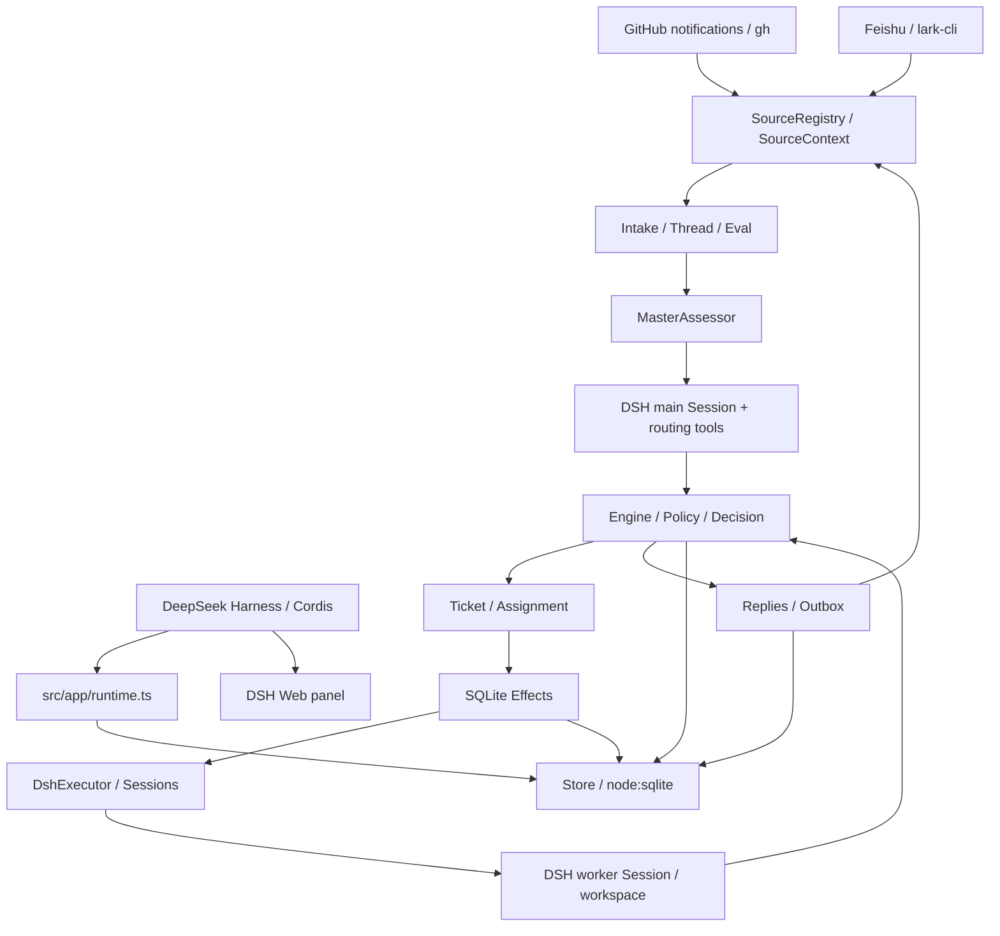

# Local Agent Orchestrator 改造计划与源码审计

> 迁移背景：本文记录旧 dsh-superagent-prototype 工作区的状态与命令。新项目可用能力以 [B0 交付记录](BOOTSTRAP.md) 为准。

审计日期：2026-11-03。基线提交：`8c32a9dc5d72c033816c6a8110b37f40cf94fba4`。

状态：**Phase 0 审计与 Phase 1 Core 解耦已完成；Phase 2 Executor 代码里程碑已完成但等待真实 CLI smoke 验收；Phase 3 DingTalk Adapter 接口已建立，具体 Issue 文档映射等待真实样例。** 各阶段完成范围以文末实际结果为准。产品愿景及 LAO 在 AI Workforce OS 中的定位见 `docs/PRODUCT_CONTEXT.md`。

## 1. 审计结论

这是一个运行在 DeepSeek Harness 内的 Cordis 插件包，不是独立服务。其领域核心已经具备很好的端口隔离；应保留 Engine、聚合、事务、副作用队列和 Outbox，而替换宿主、会话执行及模型判断机制。

关键事实：

1. `src/core` 的 15 个模块只引用核心内部模块和 `node:crypto`，**没有 DSH 包的直接或传递导入**。Phase 1 不需要假装删除不存在的 DSH 类型，而应建立独立编译/测试边界，并修正不适合 LAO 的生命周期语义。
2. SQLite 位于 `src/app/store.ts`，不是 `src/core` 或 `src/infra`；使用 Node 内置 `node:sqlite`，无需引入另一套数据库。
3. 原 Ticket 没有独立 `status`、`priority`、`source_issue_id` 字段；Assignment 内嵌于 Ticket JSON，原 `Execution` 只是 `{name, directory, assignment}`，不是执行结果记录。
4. `Assignments.report()` 收到 `ready`，没有待关闭的关联 Thread 时会自动将 Ticket 结束为 `completed`。不能原样用于“执行完成 → 人工审核 → DONE”。
5. `Assignments.interrupted()` 对未稳定的运行记录调用 `Tickets.restart()` 创建新 Assignment；没有本地 PID、进程身份或 CLI 会话核对，不能直接沿用。
6. `Intake.receive()` 按 Trigger ID 去重；不同更新事件仍可能产生新的评估。同一钉钉 Issue 的唯一 Ticket 必须增加数据库级唯一约束。
7. 现有 `WorkerSlots` 允许人的后续输入额外占用一个 worker slot，不能直接作为 LAO 的严格并发上限。
8. 当前环境找到 Claude Code CLI，但未找到可确认的钉钉 CLI。因此不能声称已具备钉钉读写能力，也不能编造命令。

## 2. 原系统真实架构



### 2.1 入口和运行机制

- `package.json`：ESM、私有包 `dsh-superagent`，`dsh.bundle.patch` 指向 `cordis.patch.yml`；没有 `lao` bin。
- `src/index.ts`：注册 DSH 插件并创建 Runtime；`Runtime extends Service`，依赖 Cordis 注入。
- `src/app/runtime.ts`：获取状态目录锁，打开 Store，组装 Sources、Effects、Sessions、MasterAssessor、DshExecutor、Engine 和 Outbox，注册宿主 HTTP；初始化主 Session 后恢复 worker。
- `src/app/passes.ts`：每 2 秒驱动 Effects 与 Eval；合并重叠 pass。它不是钉钉的 3 分钟扫描器。
- `scripts/dsh-superagent`：Python 管理脚本，围绕 DSH profile、tmux、宿主 HTTP 和进程管理；不能只改名就作为 LAO CLI。
- `tsdown.config.ts`：服务端插件和 GitHub/Feishu 插件入口，以及注入 `window.__ModuleLoader__` 的浏览器客户端构建。
- 原配置来自 Cordis 部署配置、SQLite settings 和 prompt revisions，没有独立 LAO 配置文件。

### 2.2 领域与依赖边界

| 模块 | 已有能力 | 改造判断 |
| --- | --- | --- |
| `core/model.ts` | Trigger、Thread、Evaluation、Decision、Mandate、Ticket、Assignment、输入和订阅 | 保留身份与授权关系，增量扩充任务/执行数据；区分执行结果和最终结论 |
| `core/ports.ts` | Policy、SourceScope、Assessor、Executor、Outbox、Repositories | 保留依赖反转；扩展状态、执行证据、审批和能力接口 |
| `core/engine.ts` | 所有领域命令由 `repo.atomic()` 包装 | 保留统一入口；新增显式状态转换和审核命令 |
| `core/intake.ts` | Trigger 去重、过滤、Thread 关联和 fan-out | 保留；增加 Issue 级绑定，限制关闭 Issue 的重新激活 |
| `core/evals.ts` | 批次评估、过期、Policy 校验和 Decision 审计 | 保留；适配规则 Assessor，不再等待主 Session |
| `core/tickets.ts` | 创建、订阅、重试、恢复、结束 | 修改自动 wake/restart、关闭关联 Thread 自动结束等行为 |
| `core/assignments.ts` | 启动、输入投递/read、report、interrupted | 修改 `ready` 自动完成和中断自动重跑；引入执行代次校验 |
| `core/replies.ts` | 按 purpose 授权、确定性消息 ID、Outbox | 保留；增加状态/结果回写，不让 worker 自行定义最终状态 |
| `core/stage.ts` | 从 report/ended 推导 UI stage | 不能充当新状态机；改为持久状态的展示投影 |
| `core/memory.ts` | clone 隔离、事务回滚、内存 Repository | 保留，扩展契约一致性测试 |
| `core/ids.ts`、`errors.ts`、`reasons.ts`、`part.ts`、`index.ts` | ID、错误、原因、共享设施和导出 | 保留；更新术语/事件边界 |

`core` 没有宿主依赖，并不代表整个存储/策略闭包独立：`Store → migration/prompts/context/cards`、`policy → infra/environment → deployment` 等路径引入宿主类型和应用层模块。静态导入检查必须包括 type-only 和相对路径闭包，不能只 grep `core` 后宣布系统已独立。

### 2.3 持久化与可靠性

当前 schema 为 11，支持从 schema 10 迁移，更旧或更新版本拒绝打开。Store 使用 WAL、`synchronous=FULL`、嵌套 SAVEPOINT、`afterCommit`；数据库文件权限为 0600，目录为 0700。

现有表：`trigger`、`disposition`、`trigger_thread`、`thread`、`ticket`、`decision`、`effect`、`outbox`、`kv`。主要聚合按 JSON 存储；generated columns 与 partial indexes 缩小活跃任务扫描范围。

- Effects 在事务中记录外部工作，按 kind/key 合并，按 seq/generation 防止旧执行覆盖新请求，支持退避和 drain。
- Effects 重试没有 LAO 所需的任务级固定次数上限，排序也不是 Ticket priority。
- Outbox 保留发送 receipt、按会话排序、失败重试。它不能单独解决“远端写入成功但本地未记 receipt”的崩溃窗口。
- DomainEvent 当前通过回调发送主 Session notice，不是完整持久 Event Log。
- 没有独立 Execution、Approval History、任务级 Retry History；没有 stdout/stderr 文件、PID/start-time/session-id 等 CLI 恢复信息。
- 原数据会持续增长，尚无归档和日志保留上限。

## 3. DSH 依赖清理范围

附录 A 自动列出 package.json 的全部 DeepSeek 命名空间依赖及直接源码导入位置，附录 B 列出锁文件中的传递包。不能只删除用户列出的 11 个包。

主要耦合点：

| 依赖族 | 使用位置/作用 | LAO 替代 |
| --- | --- | --- |
| Cordis、schemastery、dsh-settings | 插件注册、配置、服务生命周期 | 普通 TypeScript composition root + zod 配置 |
| dsh-agent、session、scope、llm | 主/worker agent、会话、消息、角色模型 | 规则 Assessor、通用执行协议、Claude CLI Adapter |
| api-session-controller、session-persistence | Session 创建、投递、flush、catalog | LAO ExecutionRepository 和明确 session ID |
| workspace、permission-presets、system-prompt、tools、skill | 宿主工作区和权限/工具注入 | WorktreeManager、PermissionPolicy、受控 prompt builder |
| dsh-subprocess | worker 进程环境和后台命令 | Node spawn + 可恢复本地 runner |
| dsh-attachment | 飞书图片上传到 agent | 第一版移出；将来用运行时无关附件值对象 |
| dsh-host-webserver 与 client 包 | 宿主 HTTP、Web panel、导航 | 第一版 CLI，本地控制接口；Web 后续独立实现 |

最终删除 package 的 `dsh` 元信息、`engines.dsh`、旧 exports、DSH 构建 external/loader、插件 patch、DSH 启动脚本和无用 peer/dev dependencies；重新生成锁文件，并核对传递依赖。保留 MIT LICENSE 和来源说明，不把历史归属文字误当运行时依赖。

阶段过渡中旧宿主可暂时留在原入口维持基线测试，但 LAO 独立编译闭包不得引用它。Phase 4 结束前必须完成旧宿主和依赖清除，Phase 5 再做完整残留检查。

## 4. 复用、修改、删除和新增清单

### 4.1 直接复用主体实现

- Core 的 ID、Repository 契约、内存实现、Engine 事务组织、Trigger/Thread/Decision/Mandate 等领域概念。
- `app/store.ts` 的 SQLite、savepoint、afterCommit、JSON 聚合和查询索引机制。
- `app/effects.ts` 的持久副作用队列、generation 检查及退避机制。
- `app/outbox.ts` 的 receipt、幂等入队和投递顺序机制。
- `app/passes.ts` 的重叠合并、`infra/health.ts`、`app/versions.ts`、`app/cache.ts` 的通用部分。
- `sources/poll.ts` 的重叠扫描/取消思路；不能把 14 天窗口直接用于钉钉全部 Issue。

“复用”不意味着零修改；公共基础设施应剥离旧 settings、host 类型和业务特例。

### 4.2 必须修改

- Core 生命周期、事件、Issue 级幂等、审批、执行结果和回调代次校验。
- `policy.ts`、`admission.ts`：保留版本化授权和 gate；抽离角色模型、飞书/GitHub 部署假设，增加任务类型、优先级和明确的自动执行规则。未知类型默认 BLOCKED/审批，不靠关键词猜测授权。
- Store、migration、KV、store-read：抽出独立存储闭包，增量迁移并保留历史；不能删除旧字段让旧数据库静默失真。
- Source registry/kind/host：去除 `Agent` 图片接口、部署账户与 UI 表单的混合耦合；附件改为数据。
- `infra/commands.ts`：保留 execFile/argv、超时和错误包装经验，拆成通用 CLI runner 与各服务 Adapter；不再让全局 Commands 同时知道 gh/lark/Claude/钉钉。
- `infra/environment.ts`：保留路径规范化和环境隔离经验，替换 DSH subprocess 接口；原文件明确只是 guardrail，不是操作系统安全沙箱。
- README、SETUP、构建、测试分类、模块表和运行示例随各 Phase 更新。

### 4.3 必须替换/删除旧实现

- 替换 `executor/dsh.ts`；删除 `executor/background.ts` 的 DSH job/subagent 管理。
- 替换 `app/assessment.ts` 的 MasterAssessor；保留必要验证和有界上下文思路。
- 删除 `app/sessions.ts`、`app/delivery.ts`、`app/role-models.ts`、`app/retry-health.ts` 的宿主会话实现。
- 替换 `src/index.ts`、`app/runtime.ts`、`deployment.ts`、`app/setup.ts`；删除 `app/tools/main.ts`、`executor.ts` 等 DSH 工具注册，CLI 命令继续调用 Engine。
- 第一版移除 `src/client`、`navigation.ts`、DSH HTTP/API 和专用于主 Session 的 resources/context/notices 表面；有价值的纯投影可按 CLI 需要保留。
- GitHub/Feishu source、对应 skills/prompts 和宿主面板测试退出第一版运行包；当前需求不需要保留这些集成。以后通过 Source 接口独立接回，不引入 Harness。
- 删除 `cordis.patch.yml`、旧服务脚本和已失效的 bundle/client 专用测试；保留并迁移其中有价值的行为断言，不以删测试掩盖回归。

### 4.4 新增模块及推荐目录

尽量保留 `src/app/store.ts` 等原路径，避免为目录美观大规模搬家：

```text
src/core/                     # 增量扩展原核心；增加 lifecycle/approval 契约
src/assessor/rule-assessor.ts
src/assessor/model-provider.ts # 仅接口；AI assessor 后续可选
src/executor/base.ts           # AgentExecutor + capability/result types
src/executor/claude-code.ts
src/executor/registry.ts
src/executor/worktrees.ts
src/executor/runner.ts         # 子进程监督、文件日志、退出记录
src/sources/dingtalk/adapter.ts
src/sources/dingtalk/mapper.ts
src/sources/dingtalk/polling.ts
src/sources/dingtalk/index.ts
src/app/runtime.ts             # 独立 composition root
src/app/scheduler.ts
src/app/recovery.ts
src/app/store.ts               # 复用、扩表
src/app/migration.ts
src/app/effects.ts
src/app/outbox.ts
src/config/settings.ts
src/cli/index.ts
src/infra/process.ts
src/infra/logging.ts
```

不开发自己的 Agent 推理循环。Orchestrator 只接受执行事实、执行策略和状态转换，Agent 不能直接访问/修改 LAO 数据库。

## 5. 本机 CLI 能力核验

### 5.1 Claude Code

实际执行了 `command -v claude`、`claude --version`、`claude --help`：

- 路径：`/opt/homebrew/bin/claude`；版本：`2.1.181 (Claude Code)`。
- `-p/--print`：非交互模式。
- `--output-format`：`text | json | stream-json`；`--input-format`：`text | stream-json`。
- `--json-schema`、`--verbose`、`--include-partial-messages`、`--replay-user-messages` 在本机 help 中存在。
- `--resume`、`--session-id <uuid>` 支持指定恢复/新会话；`--no-session-persistence` 会禁用恢复，LAO 不默认启用。
- `--permission-mode` 可选 `acceptEdits | auto | bypassPermissions | default | dontAsk | plan`；默认方案使用 `default` 和最小工具授权，不启用 bypass/危险权限。
- `--tools`、`--allowedTools`、`--disallowedTools`、`--settings`、`--setting-sources`、`--strict-mcp-config` 存在；具体权限组合必须用拒绝场景测试验证。
- `--worktree` 存在，但推荐由 LAO 用 Git argv 自己管理工作树和锁，便于可靠记录、恢复和清理。
- cwd 由 Node `spawn` 的 `cwd` 传递，不编造 `claude --cwd` 参数。

本阶段没有调用模型、检查私密凭证或运行真实修改任务。CLI 登录是否可用、实际 JSON/stream-json 事件 schema、Token 字段和恢复效果均需 Phase 2 捕获脱敏 fixture 并实测；help 存在不是端到端验收。

能力策略：

| 操作 | 第一版策略 | 不可用时的真实行为 |
| --- | --- | --- |
| start | `-p` + 结构化输出；必要 streaming 组合按本机实测固定 | spawn/权限/协议失败进入 FAILED/BLOCKED |
| status / collect | LAO runner 状态、持久执行记录、输出解析 | 不把进程消失视为成功 |
| stop | 校验进程身份后终止进程组，宽限后强制终止 | 无法确认终止则保留 BLOCKED 和锁，禁止新执行 |
| deliver | Phase 2 验证 stream-json 实时输入；未验证先声明不支持 active delivery | 持久化后续输入，原进程结束后显式 resume；只返回 queued，不返回 delivered |
| resume | 使用已记录的明确 session ID 和原 worktree，确认旧进程已结束 | 无有效会话进入 BLOCKED，禁止悄悄创建全新任务 |

ModelProvider 是结构化任务理解接口，与 ClaudeCodeExecutor 完全不同。第一版没有 ModelProvider 实现也必须正常调度。

### 5.2 钉钉

检查了 PATH 内可执行文件、常见命令名 `dingtalk` / `ding` / `dingtalk-cli` / `dt`、Homebrew bin/Cellar、用户 local/bin/config、NVM/global npm 和桌面有限深度安装候选。**未定位到可确认的钉钉 CLI；这不等于断言机器绝对没有安装。** 没有可执行目标，因此无法执行可信的 `--help`、核验 JSON 或读写文档。

未读取或输出凭证内容，也没有修改远端文档。需要用户提供：

1. CLI 的实际命令名或可执行文件绝对路径；如依赖 shell alias/wrapper，提供 wrapper 路径。
2. 用于验收的钉钉文档/表 ID 或链接，以及 Issue 存储形态：文档段落、表格行、多维表还是专用 Issue 对象。
3. ID/标题/描述/状态/优先级/时间字段映射；读取范围与允许回写的状态/结果列。
4. CLI 已登录的账户/配置选择方式及可读写范围（不需要把 token 发到聊天）。

拿到路径后按 `--help → 子命令 help → 配置元数据/只读健康检查 → JSON 样例 → 测试文档读写` 核验。Phase 3 的真实验收必须用实际 CLI；mock 只能验证内部契约。

拟定接口（不是假 CLI 封装）：

```ts
interface DingTalkAdapter {
  healthCheck(signal: AbortSignal): Promise<HealthResult>
  listIssues(query: IssueQuery, signal: AbortSignal): Promise<IssuePage>
  getIssue(issueId: string, signal: AbortSignal): Promise<SourceIssue>
  updateIssue(issueId: string, update: IssueUpdate,
    context: WriteContext, signal: AbortSignal): Promise<WriteReceipt>
  addComment(issueId: string, content: string,
    context: WriteContext, signal: AbortSignal): Promise<WriteReceipt>
}
```

`WriteContext` 包含 operationId 和可选 expectedRevision；Adapter 显式声明分页、评论、条件更新和幂等写能力。缺少评论能力时返回 unsupported，可以在已验证的结果字段回写；没有稳定 Issue ID 时必须配置稳定行 ID，不能用标题代替。缺少必要写能力则 Phase 3 阻塞，不能伪造成功。

## 6. LAO 生命周期、数据与接口设计

### 6.1 状态机

状态作为持久领域事实；stage 仅用于显示。Phase 1 建立转换函数和非法转换测试，后续阶段接入真实执行。

| 状态 | 进入条件 | 允许的下一状态 |
| --- | --- | --- |
| NEW | 新 Issue 的接入和来源绑定已原子提交 | QUEUED、WAITING_APPROVAL、BLOCKED、CANCELLED |
| WAITING_APPROVAL | 明确策略要求执行前审批 | QUEUED（通过且前置条件仍成立）、CANCELLED、BLOCKED |
| QUEUED | 可执行、审批有效、等待优先级队列 | ASSIGNED、WAITING_APPROVAL、BLOCKED、CANCELLED |
| ASSIGNED | 已原子领取、分配 runtime/worktree、保存 launch intent | RUNNING、FAILED、BLOCKED、CANCELLED |
| RUNNING | 已确认本次 runner/进程启动 | REVIEW、FAILED、BLOCKED、CANCELLED |
| REVIEW | 有可信结构化结束证据，产物已收集；等待验证/人审 | DONE、QUEUED（明确返工）、BLOCKED、CANCELLED |
| DONE | 完成策略要求的验证，必要人工审批已记录 | 默认终态；显式 reopen 审计后才可回 QUEUED |
| FAILED | 已确认执行失败、超时或异常退出 | QUEUED（符合重试策略）、BLOCKED、CANCELLED |
| BLOCKED | 缺信息/权限、恢复不确定或需人工处理 | WAITING_APPROVAL、QUEUED、REVIEW（补齐既有结果）、CANCELLED |
| CANCELLED | 人工取消或来源关闭策略取消 | 默认终态；显式重新授权才可回 QUEUED |

取消 RUNNING 先记录 cancelRequested，确认进程组停止后落 CANCELLED；确认失败落 BLOCKED，不释放执行锁。恢复时核对 PID 身份、runner receipt 后可保持 RUNNING，不算新执行。DONE/CANCELLED 不因轮询或普通文档更新自动重开。

`exit_code=0` + 合法 terminal result + 非错误标记 + 收集到预期产物，只足以请求 REVIEW。CI 记录独立为 unknown/pending/passed/failed/not_required；未运行不得标记 passed。人工审核记录 actor、decision、reason、policyVersion、executionId/commit hash 和时间。产物或授权范围变化使既有审批失效。默认完成需要人工审核；明确低风险自动完成策略也必须经过 REVIEW 验证步骤。

### 6.2 持久化扩展

保留 JSON 聚合，避免一次性改成新 ORM。增加字段/表及可查询索引：

- Ticket：source instance、source_issue_id、description、priority、taskType、status、version、已有 createdAt/updatedAt 和授权记录。
- `source_issue`：`UNIQUE(source_instance, issue_id)`，ticket_id、source_updated_at、revision/contentHash、远端状态、last_seen_at、last_written_operation。
- Assignment：保留领域绑定与历史；增加 agent_id/runtime/worktree_path/process_id/process_start_time/runner_id/session_id/attempt/status/timestamps。第一版可继续内嵌聚合，另建执行锁与索引；查询投影不能成为第二套冲突事实源。
- `execution`：execution_id、ticket_id、assignment_id、脱敏 input/output/error、stdout/stderr 路径、exit_code、signal、duration、usage（允许 unknown）、开始/完成时间、结构化结果、产物/commit 引用。
- `execution_lock`：Ticket/worktree 唯一活动锁、owner、generation、heartbeat/lease。lease 超时只触发核查，不直接允许重复执行。
- `approval_history`、`retry_history`、`event_log`：追加式历史；在状态事务内写入，事件包含旧/新状态、原因、关联 ID。
- 保留 Trigger/Decision/Thread/Policy versions/Effects/Outbox，新增持久轮询 checkpoint 和回写操作。

建议 LAO schema 从 12 开始，支持 schema 11 → 12 的明确迁移。历史 active DSH Assignment 标记“旧运行时不可恢复”并 BLOCKED，绝不映射为 Claude 任务自动执行；schema 10 如需支持先完成原数据迁移再转换，不要求安装 DSH 才可迁移。迁移前备份，遇到未知/更新 schema 拒绝；事务失败保持原数据。

### 6.3 队列与执行接口

保持 Core 同步事务，不在 `atomic()` 内 await 或 spawn。Core 的 Executor 命令端口由应用层 facade 实现，只持久化 effect；应用层调度器在提交后调用异步 AgentExecutor。

AgentExecutor 提供 `start/deliver/stop/status/collect`，并提供可选 `resume`、能力声明和明确的 unsupported 结果。Runtime DTO 不包含 DSH Session/Agent 类型。注册表第一版仅 `claude-code`，未来按能力路由。

队列按 priority 降序、queued_at 升序、ticket_id 稳定排序；严格 `max_concurrency`（包括启动中和恢复中的占位），初始值 1。每次执行有独立 assignment/execution ID，同一 Ticket 只允许一个活动执行。自动重试采用次数上限、退避、错误分类与幂等检查；鉴权/权限/输入问题不自动重试，有外部副作用且结果不明必须 BLOCKED。手动 retry 仍必须核查旧进程，不绕过授权。

### 6.4 工作树、安全与恢复

- WorktreeManager 验证 Git repo、base commit、路径 realpath 和目录归属；使用固定 argv 的 `git worktree add`，Ticket ID 生成安全目录/分支名，不拼接 Issue 文本到 shell。
- 同一 Ticket 重试可保留原 worktree，但必须串行并记录起点；不同 Ticket 使用不同 worktree。删除有未提交更改的 worktree 必须单独批准。
- cwd/worktree 不是操作系统安全边界。第一版默认只授权必要文件工具，不给不受限制的 Bash；如需 shell，使用验证过的沙箱/权限规则与受控动作代理。仅靠 prompt、危险词匹配或 PATH shim 不足以保证 push/发布/删除审批。
- 高风险动作由独立 approval gate 执行具体已批准动作，审批绑定参数、仓库、产物 revision；不通过整个任务审批解锁任意后续 shell。
- Worker 不继承钉钉凭证、LAO 控制凭证和无关环境；Claude 所需认证只在运行环境注入，不写 Ticket 或 argv/log。禁用未经审核的项目 hooks/MCP/插件继承，具体配置用 Phase 2 实测确认。
- 日志按 Ticket/Assignment/Execution 关联；流式脱敏后保存，覆盖 token、Authorization、私钥和配置中的敏感值，限制长度和磁盘容量。stdout/stderr 原文可能含秘密，不应先落原文再做展示脱敏。
- 建议独立 runner 监督 Claude，持续写日志、heartbeat 和原子 terminal receipt；主进程重启后可重新读取文件，而不是声称能重新连接已丢失的 stdout pipe。
- 重启先获取实例锁并禁用派发，再核对 PID + 启动时间 + 可执行文件/runner nonce，防止 PID 复用。存活且可验证的 runner 恢复监控并占用 slot；PID 存活但不能监控则 BLOCKED 且不重跑；确认进程死亡才核对 terminal receipt/session。
- launch intent 已写但 PID 尚未持久化的崩溃窗口，需要 runner nonce/receipt 找回；无法排除已经启动就 BLOCKED。恢复本身不能绕过该检查。
- 优雅停止：停止轮询和派发、发出中断、等待有限时间、核对所有子进程、保存状态/日志、关闭 SQLite、最后释放锁。丢失实例锁后停止新执行。

### 6.5 钉钉轮询和回写

1. 每 180 秒扫描，单个 source 不重叠；支持分页、超时、限流与退避。
2. 按 source instance + Issue ID 原子 upsert。Trigger ID 包含 Issue 的稳定 revision 或规范化内容 hash，而 Ticket 绑定不随 revision 改变。
3. 同 revision 跳过；旧版本不覆盖新版本；缺少更新时间时用内容 hash。扫描 checkpoint 仅在接入提交后推进，局部失败重扫依赖幂等。
4. 新的可接入 Issue 建 Trigger/Ticket；关闭 Issue 记录来源状态但不执行。运行中的更新变为输入，不再分配第二个执行；关闭/撤销触发取消策略。
5. 状态变化与回写操作同事务入 Outbox。优先条件更新和远端 operationId；评论用可检索幂等标记。远端不提供核对能力时承认 ambiguous write，进入人工处理，不能承诺 exactly-once。
6. 区分自身回写和用户内容修改，避免 RUNNING/REVIEW 等回写被下一次轮询当成新任务。
7. source mapping 与内部转换分开：钉钉“执行成功”不会越过 LAO 人审直接写 DONE；外部关闭不等于代码成功。

初始可配置映射：待处理→NEW、处理中→RUNNING、待审核→REVIEW、成功→DONE、失败→FAILED、人工介入→BLOCKED、关闭/取消→CANCELLED；映射需按真实文档字段确认，未知值停止自动执行。

## 7. 配置与运维计划

优先采用 JSON + zod（无需额外 YAML 依赖），`lao init` 写模板和独立 state directory；可以后续添加 YAML 解析。

配置包括 app 名称/时区/log level；scheduler poll interval/max concurrency/retry limit/backoff；dingtalk cli path/source scope/field mapping/status mapping/timeout；agent repository/worktree root/base ref/timeout；claude command/已验证的 output format/permission mode；security approval policy；日志保留上限。

CLI：`lao init`、`doctor`、`start`、`stop`、`status`、`tickets`、`create`（Phase 2 手动任务）、`retry <id>`、`cancel <id>`、`logs <id>`、`approve <id>`、`reject <id>`、显式 `resume/reopen`。doctor 检查 Node/Git/CLI、配置、数据库/锁、仓库可访问性；不执行真实任务或远端写操作。

第一版允许前台常驻，后台模式使用受控子进程和 PID 身份验证，不依赖 Docker/Redis/PostgreSQL/tmux。运行中的写命令通过本地控制通道进入唯一 daemon；不允许第二个 CLI 进程直接打开数据库与 daemon 竞争写入。控制接口限制本机用户，读日志不泄露凭证。

## 8. 测试审计与质量门禁

源码统计：110 个 TS/TSX 模块，约 15,205 行；tests 65 个 TS/TSX 文件，其中 59 个 spec，约 14,960 行。统计不含依赖、构建产物和 CSS。

已有测试覆盖面：

- 核心：`core-engine`、`stage`、`policy`、`followups`、`admission-context`。
- 存储和队列：`store`、`migration`、`effects`、`outbox`、`passes`、`queue`。
- 原执行/宿主集成：`runtime`、`runtime-concurrency`、`background`、`delivery`、`assessment`、`tools`；使用 fake DSH host，不能等同真实 Agent E2E。
- 来源：`sources`、`github-read`、`feishu-read`、`feishu-image`、`registry`。
- 环境/管理：`environment`、`deployment`、`commands`、`service-script`、`http`、`settings`、`health`。
- 大量 panel、prompt、locale、文档和模块清单测试。

没有配置覆盖率阈值或现成的 LAO 集成测试脚本，不报告未经测量的代码覆盖率百分比。没有 Claude CLI、钉钉、PID 恢复、任务审批等 LAO 测试。

基线验证记录见本文件末尾。运行 pnpm 时自动准备了仓库原有锁定依赖；这仅用于原项目基线，未新增依赖声明，也不是 LAO 的运行方案。没有启动 DSH 服务或调用 DeepSeek 模型。

每阶段门禁：TypeScript 类型检查、相关单元测试、相关集成测试、构建、依赖闭包检查和文档更新；先通过再进入下一阶段。独立区分 unit/integration/需凭证 live-e2e，真实验收未完成必须写明阻塞，不能以 skipped/mock 代替通过。

必须新增的故障测试：重复/乱序/关闭 Issue、并发领取、过期回调、非法转换、stdout 截断/坏 JSON/错误 terminal result、超时和进程树取消、spawn 前后崩溃、PID 复用、存活 worker 恢复、丢失 session、回写成功但 receipt 丢失、锁丢失、磁盘/数据库错误、审批失效、日志脱敏、未知 CLI 版本和权限拒绝。

## 9. 分阶段实施与验收

| Phase | 实施范围 | 必须满足的验收 |
| --- | --- | --- |
| 0 审计 | 本文、依赖/模块/测试/CLI 能力清单 | 计划可审阅，基线结果如实记录；用户确认后才进入 Phase 1 |
| 1 Core 独立边界 | 保留原模型/Engine/Repository；隔离 Store/Policy 闭包；显式状态与审批契约、Issue 唯一绑定、独立 Core 构建 | Core/存储目标无需 DSH 类型或包可编译运行；内存/SQLite 契约、事务回滚、幂等和状态测试通过；其余原基线无新增回归 |
| 2 Claude Executor | AgentExecutor、WorktreeManager、runner、结构化结果、超时/日志/停止、最小 CLI create | fake CLI 故障测试 + 临时 Git 仓库真实 Claude 修改；保存实际 PID/session/result/usage（有则记录）；产物进入 REVIEW；active deliver/resume 能力逐项实测或明确 unsupported |
| 3 DingTalk Source | 真实 CLI 探测、Adapter、字段映射、读取/更新、poll/outbox | 真实测试 Issue → 唯一 Ticket → 状态/结果回写；重复轮询、关闭、更新、分页和回写重试测试通过；CLI/权限未确认不得标记本阶段完成 |
| 4 独立 Runtime | 规则 Assessor 全闭环、优先级/并发/重试、daemon/CLI、恢复与优雅退出；移除全部旧宿主及依赖 | Issue→Ticket→Assignment→Claude→REVIEW→人工确认→DONE→钉钉完整演示；连续运行建议 24h 并记录；多次强杀/重启无重复执行；干净安装/构建不拉取 DSH |
| 5 安全稳定性 | 审批执行约束、审计、日志脱敏、进程边界、容量和故障测试 | 高风险动作无批准被拒；审批与执行 revision 绑定；故障矩阵通过；包/lock/import/脚本/文档检查无残留运行依赖；恢复/备份/运维手册完成 |
| 6 扩展接口 | Codex executor、AgentRegistry/router、CIProvider、Web/钉钉审批、质量统计的契约 | 接口及契约测试/说明，不实现第二个推理 runtime、不扩大第一版范围 |

安全不能全等到 Phase 5：权限默认值、审批 gate、工作范围、脱敏和执行锁分别在首次引入的 Phase 1/2/3 中实现；Phase 5 是全面加固。

Phase 1 推荐拆成小提交：独立测试/编译边界 → Store/Policy 依赖分离 → 状态与审批契约 → Issue 唯一绑定/审计迁移。先保留所有合理领域不变量，逐项替换 `ready=end`、`restart=rerun`、`human update=wake` 的旧语义，并解释测试变化。

## 10. 主要风险与待确认项

| 风险 | 影响 | 应对 |
| --- | --- | --- |
| 钉钉 CLI 未定位、Issue 形态不明 | Phase 3 无法真实验收 | 提供真实路径和测试文档，先测 capabilities，绝不猜命令 |
| Claude 协议/权限行为与 help 不完全等价 | 活跃输入、恢复和代码修改可能失败 | 本地版本探测 + fixtures + 真实临时仓库 E2E |
| SQLite 与外部进程无法同事务 | 崩溃可能导致重复启动 | intent/runner nonce/receipt/进程身份，结果不明 BLOCKED |
| 远端写入与本地 receipt 无分布式事务 | 重复评论、覆盖用户变更 | operationId、revision/CAS、读后核对；无法核对不盲重试 |
| Worktree 不隔离用户凭证/系统文件 | 越权 shell 或提示注入 | 最小工具权限、受控环境/动作、可验证沙箱；prompt 不作为授权 |
| 现有状态语义分散且由 worker report 驱动 | 错标 DONE、自动唤醒关闭任务 | 统一转换、结果验证与人审分离、审计 |
| Store 与 UI/Prompt/Source 类型闭包相连 | 删 DSH 后编译失败或假解耦 | 编译边界及传递 import 检查，剥离接口而非删除类型 |
| 旧 schema/已运行 DSH 任务 | 迁移丢数据或错误接续 | 备份、迁移 fixture、旧活动任务 BLOCKED |
| 现有测试量大但以宿主模拟为主 | 误以为完整闭环已经验证 | 分层测试 + 本机 live E2E + 连续运行记录 |

工程难度最高的是进程恢复、审批执行边界和远端幂等，其次是生命周期迁移；CLI 包装本身不是主要难点。钉钉资料和真实认证验证决定最终交付时间，当前不承诺缺乏依据的固定工期。

当前需要的确认仅为本改造计划；用户已明确要求确认后才进入 Phase 1。钉钉路径/文档信息可同时补充，不妨碍先完成 Core 阶段。

## 附录 A：直接依赖与源码引用清单

以下清单由基线 package.json 与源码 import 扫描生成；包括类型导入。

| 包 | 声明位置 | 直接导入模块 |
| --- | --- | --- |
| `@deepseek-ai/cordis` | peerDependencies, devDependencies | `src/app/delivery.ts`, `src/app/http.ts`, `src/app/resources.ts`, `src/app/role-models.ts`, `src/app/runtime.ts`, `src/app/sessions.ts`, `src/app/settings.ts`, `src/app/setup.ts`, `src/app/tools/main.ts`, `src/client/index.tsx`, `src/deployment.ts`, `src/executor/background.ts`, `src/executor/dsh.ts`, `src/index.ts`, `src/sources/feishu.ts`, `src/sources/github.ts` |
| `@deepseek-ai/dsh-agent` | peerDependencies, devDependencies | `src/app/assessment.ts`, `src/app/delivery.ts`, `src/app/role-models.ts`, `src/app/runtime.ts`, `src/app/sessions.ts`, `src/app/tools/main.ts`, `src/executor/background.ts`, `src/executor/dsh.ts`, `src/sources/feishu-image.ts`, `src/sources/kind.ts` |
| `@deepseek-ai/dsh-api-session-controller` | peerDependencies, devDependencies | `src/app/api.ts`, `src/app/http.ts`, `src/app/runtime.ts`, `src/client/index.tsx`, `src/navigation.ts` |
| `@deepseek-ai/dsh-attachment` | peerDependencies, devDependencies | `src/sources/feishu-image.ts` |
| `@deepseek-ai/dsh-client-locale` | peerDependencies, devDependencies | `src/client/index.tsx` |
| `@deepseek-ai/dsh-client-ui-layout` | peerDependencies, devDependencies | `src/client/index.tsx` |
| `@deepseek-ai/dsh-client-ui-plugin-manager` | devDependencies | `src/client/deployment.tsx`, `src/client/index.tsx` |
| `@deepseek-ai/dsh-client-ui-renderer` | peerDependencies, devDependencies | `src/client/index.tsx` |
| `@deepseek-ai/dsh-client-ui-settings` | peerDependencies, devDependencies | `src/client/deployment.tsx`, `src/client/index.tsx` |
| `@deepseek-ai/dsh-client-ui-sidebar` | peerDependencies, devDependencies | `src/client/index.tsx` |
| `@deepseek-ai/dsh-client-ui-slots` | peerDependencies, devDependencies | `src/client/text.ts` |
| `@deepseek-ai/dsh-client-ui-workspace` | peerDependencies, devDependencies | `src/client/index.tsx` |
| `@deepseek-ai/dsh-host-webserver` | peerDependencies, devDependencies | `src/app/http.ts` |
| `@deepseek-ai/dsh-llm` | peerDependencies, devDependencies | `src/app/delivery.ts`, `src/app/role-models.ts`, `src/app/sessions.ts`, `src/sources/feishu-image.ts` |
| `@deepseek-ai/dsh-permission-presets` | peerDependencies, devDependencies | `src/app/runtime.ts` |
| `@deepseek-ai/dsh-scope` | peerDependencies, devDependencies | `src/app/sessions.ts` |
| `@deepseek-ai/dsh-session` | peerDependencies, devDependencies | `src/app/context.ts`, `src/app/delivery.ts`, `src/app/resources.ts`, `src/app/runtime.ts`, `src/app/sessions.ts`, `src/client/index.tsx`, `src/executor/background.ts`, `src/executor/dsh.ts`, `src/navigation.ts` |
| `@deepseek-ai/dsh-session-persistence` | peerDependencies, devDependencies | `src/app/delivery.ts`, `src/app/runtime.ts` |
| `@deepseek-ai/dsh-settings` | devDependencies | `src/index.ts` |
| `@deepseek-ai/dsh-skill` | peerDependencies, devDependencies | `src/app/runtime.ts` |
| `@deepseek-ai/dsh-subprocess` | peerDependencies, devDependencies | `src/app/runtime.ts`, `src/deployment.ts`, `src/infra/environment.ts` |
| `@deepseek-ai/dsh-system-prompt` | peerDependencies, devDependencies | `src/app/runtime.ts` |
| `@deepseek-ai/dsh-tools` | peerDependencies, devDependencies | `src/app/runtime.ts` |
| `@deepseek-ai/dsh-workspace` | peerDependencies, devDependencies | `src/app/runtime.ts` |
| `@deepseek-ai/schemastery` | peerDependencies, devDependencies | `src/deployment.ts` |

## 附录 B：锁文件 DeepSeek 命名空间包

基线共有 77 个不同包名（含直接和传递依赖）。最终独立安装要求这一集合为空；不是只在构建时 external。

```text
@deepseek-ai/cordis
@deepseek-ai/cordis-plugin-group
@deepseek-ai/cordis-plugin-include
@deepseek-ai/cordis-plugin-loader
@deepseek-ai/cosmokit
@deepseek-ai/dsh-agent
@deepseek-ai/dsh-agent-default-model
@deepseek-ai/dsh-agent-preset-registry
@deepseek-ai/dsh-api-gateway
@deepseek-ai/dsh-api-session-controller
@deepseek-ai/dsh-app-boot
@deepseek-ai/dsh-atomic-write
@deepseek-ai/dsh-attachment
@deepseek-ai/dsh-brand
@deepseek-ai/dsh-chunked-list
@deepseek-ai/dsh-client-connection
@deepseek-ai/dsh-client-file-upload
@deepseek-ai/dsh-client-locale
@deepseek-ai/dsh-client-ui-layout
@deepseek-ai/dsh-client-ui-plugin-manager
@deepseek-ai/dsh-client-ui-renderer
@deepseek-ai/dsh-client-ui-settings
@deepseek-ai/dsh-client-ui-sidebar
@deepseek-ai/dsh-client-ui-slots
@deepseek-ai/dsh-client-ui-workspace
@deepseek-ai/dsh-commands
@deepseek-ai/dsh-compaction
@deepseek-ai/dsh-compaction-image-offload
@deepseek-ai/dsh-config-editor
@deepseek-ai/dsh-credentials
@deepseek-ai/dsh-deque
@deepseek-ai/dsh-file-reference
@deepseek-ai/dsh-fs
@deepseek-ai/dsh-home-paths
@deepseek-ai/dsh-host-webserver
@deepseek-ai/dsh-http-proxy
@deepseek-ai/dsh-launch-environment
@deepseek-ai/dsh-llm
@deepseek-ai/dsh-native-command
@deepseek-ai/dsh-package-manifest
@deepseek-ai/dsh-permission-presets
@deepseek-ai/dsh-ptc-runtime
@deepseek-ai/dsh-sandbox
@deepseek-ai/dsh-sandbox-policy
@deepseek-ai/dsh-scope
@deepseek-ai/dsh-session
@deepseek-ai/dsh-session-format
@deepseek-ai/dsh-session-format-catalog
@deepseek-ai/dsh-session-format-v0-to-v1
@deepseek-ai/dsh-session-format-v1-to-v2
@deepseek-ai/dsh-session-format-v2-to-v3
@deepseek-ai/dsh-session-format-v3-to-v4
@deepseek-ai/dsh-session-persistence
@deepseek-ai/dsh-session-projection
@deepseek-ai/dsh-session-query
@deepseek-ai/dsh-session-title
@deepseek-ai/dsh-settings
@deepseek-ai/dsh-shell
@deepseek-ai/dsh-skill
@deepseek-ai/dsh-storage
@deepseek-ai/dsh-storage-domain
@deepseek-ai/dsh-subagent
@deepseek-ai/dsh-subprocess
@deepseek-ai/dsh-system-prompt
@deepseek-ai/dsh-timeout
@deepseek-ai/dsh-tool-todo
@deepseek-ai/dsh-tools
@deepseek-ai/dsh-typert-protocol
@deepseek-ai/dsh-typert-registry
@deepseek-ai/dsh-user-approval
@deepseek-ai/dsh-util-crypto
@deepseek-ai/dsh-util-time
@deepseek-ai/dsh-util-values
@deepseek-ai/dsh-util-workspace-path
@deepseek-ai/dsh-working-directory
@deepseek-ai/dsh-workspace
@deepseek-ai/schemastery
```

## 附录 C：源码审计索引

下面列出全部 TS/TSX 模块，便于按层追踪改造范围。详细职责参见原 `docs/007-architecture.md`；当前文件不将规划中的模块记作已实现。

### src/core

`src/core/assignments.ts`, `src/core/engine.ts`, `src/core/errors.ts`, `src/core/evals.ts`, `src/core/ids.ts`, `src/core/index.ts`, `src/core/intake.ts`, `src/core/memory.ts`, `src/core/model.ts`, `src/core/part.ts`, `src/core/ports.ts`, `src/core/reasons.ts`, `src/core/replies.ts`, `src/core/stage.ts`, `src/core/tickets.ts`

### src/executor

`src/executor/background.ts`, `src/executor/dsh.ts`

### src/app

`src/app/api.ts`, `src/app/assessment.ts`, `src/app/cache.ts`, `src/app/cards.ts`, `src/app/context.ts`, `src/app/delivery.ts`, `src/app/effects.ts`, `src/app/execution-environment.ts`, `src/app/http.ts`, `src/app/links.ts`, `src/app/migration.ts`, `src/app/notices.ts`, `src/app/outbox.ts`, `src/app/passes.ts`, `src/app/prompts.ts`, `src/app/resources.ts`, `src/app/retry-health.ts`, `src/app/role-models.ts`, `src/app/runtime.ts`, `src/app/sessions.ts`, `src/app/settings-history.ts`, `src/app/settings.ts`, `src/app/setup.ts`, `src/app/skill-files.ts`, `src/app/source-context.ts`, `src/app/store-read.ts`, `src/app/store.ts`, `src/app/versions.ts`, `src/app/tools/executor.ts`, `src/app/tools/main.ts`, `src/app/tools/tool.ts`, `src/app/views/overview.ts`, `src/app/views/records.ts`, `src/app/views/settings.ts`, `src/app/views/sources.ts`, `src/app/views/text.ts`, `src/app/views/threads.ts`, `src/app/views/tickets.ts`

### src/sources

`src/sources/admission-context.ts`, `src/sources/feishu-channel.ts`, `src/sources/feishu-image.ts`, `src/sources/feishu-loops.ts`, `src/sources/feishu-read.ts`, `src/sources/feishu-trigger.ts`, `src/sources/feishu.ts`, `src/sources/github-channel.ts`, `src/sources/github-pull.ts`, `src/sources/github-read.ts`, `src/sources/github-trigger.ts`, `src/sources/github.ts`, `src/sources/host.ts`, `src/sources/kind.ts`, `src/sources/poll.ts`, `src/sources/registry.ts`

### src/infra

`src/infra/commands.ts`, `src/infra/environment.ts`, `src/infra/health.ts`, `src/infra/paths.ts`, `src/infra/text.ts`

### src/client

`src/client/api.ts`, `src/client/css.d.ts`, `src/client/locales.ts`, `src/client/markdown.ts`, `src/client/marks.ts`, `src/client/prompt-config.ts`, `src/client/route.ts`, `src/client/text.ts`, `src/client/app.tsx`, `src/client/controls.tsx`, `src/client/deployment.tsx`, `src/client/draft.tsx`, `src/client/eval.tsx`, `src/client/execution.tsx`, `src/client/index.tsx`, `src/client/overview.tsx`, `src/client/prompts.tsx`, `src/client/provider.tsx`, `src/client/rows.tsx`, `src/client/settings-kit.tsx`, `src/client/settings.tsx`, `src/client/source.tsx`, `src/client/thread.tsx`, `src/client/ticket.tsx`, `src/client/trigger.tsx`, `src/client/widgets.tsx`

### src

`src/admission.ts`, `src/deployment.ts`, `src/index.ts`, `src/kv.ts`, `src/limits.ts`, `src/navigation.ts`, `src/policy.ts`, `src/setup.ts`

## 附录 D：Phase 0 实际验证记录

环境：Node `v22.23.1`，项目指定 pnpm `11.7.0`，macOS 本地工作区。

| 检查 | 实际结果 |
| --- | --- |
| 首次沙箱内 pnpm 命令 | pnpm 准备工具目录时 EPERM；随后申请并获得沙箱外执行授权 |
| 沙箱外 `pnpm check` 的 typecheck | 通过 |
| 沙箱外 `pnpm check` 的测试 | 59 个文件：58 通过、1 失败；1197 项：1196 通过、1 失败 |
| 唯一基线失败 | `tests/environment.spec.ts:93` 断言 `no email was given`，本机 Git 返回中文；不是身份隔离失效的证据 |
| `LC_ALL=C LANG=C pnpm check` 复验 | typecheck 通过；语言断言仍失败，测试自行构造 env 丢弃语言变量；另有 8 项 service-script 超时及 listen EPERM，属于本次沙箱不允许本机监听，不能混为源码回归 |
| 单独 `pnpm build` | 通过：ESM、CJS、声明文件均构建成功；有 CommonJS 建议提示 |
| 源码依赖扫描 | Core 的 15 模块闭包无外部 DeepSeek import；package 声明 25 个 DeepSeek 命名空间包；锁文件含 77 个不同包名 |
| 工作区检查 | 业务源码、package.json、pnpm-lock.yaml、测试未修改；仅新增本计划；node_modules/lib 为验证生成的 ignored 产物 |

没有执行真实 Claude 代码任务和钉钉远端读写；没有声称 Phase 1–6 完成。尚未测量代码覆盖率。基线语言断言将在后续阶段以明确子进程 locale 或与语言无关的失败断言修正，本阶段不顺带改代码。

新增文档后的定向验证：沙箱外 `pnpm exec vitest run tests/service-script.spec.ts tests/docs.spec.ts`，**2 个文件、21 项测试全部通过**。这也确认上一次 service-script 的额外失败来自沙箱监听限制。完整测试套件仍保留前述 1 项语言相关基线失败，不报告为全绿。


## Phase 1 实际结果（2026-11-04）

Phase 1 已完成：原 Core/SQLite Repository 被用于独立边界；新增显式任务生命周期、执行证据/验证/人工审批、Issue 唯一约束、事务事件审计及有备份的 schema 11 导入；完整记录见 `docs/PHASE1_CORE.md`。

验收：`pnpm check:core` 通过（独立类型检查、184 项测试、构建和无 node_modules smoke）；全仓 `pnpm typecheck` 通过；文档与 class-docs 7 项通过；`git diff --check` 通过。完整套件最近一次 62 个文件、1234 项测试全通过，之后增加两项测试，本次已由 Core 套件覆盖。旧宿主及其依赖仍在，Claude/DingTalk 适配、后台调度和真实进程恢复仍待 Phase 2–4。

## Phase 2 实际结果（2026-11-04）

完成运行时无关 Executor 接口、Claude Code 子进程适配、Git Worktree 管理、限时与有界输出、结构化结果校验和执行证据指纹；详情与边界见 `docs/PHASE2_CLAUDE_EXECUTOR.md`。`pnpm check:executor` 对 standalone Core/LAO Executor 做类型检查、mock CLI 集成测试和构建。

本机 CLI help/version 检查显示 Claude Code `2.1.181` 并提供相关模式选项；测试仅通过 mock CLI，未调用真实模型。真实 stdin/result 协议、模型调用、父进程重启恢复、DingTalk 闭环和权限审批联动仍未验收。Phase 2 作为代码里程碑完成，作为真实 Runtime 验收仍待一项小规模、明确授权的 live smoke。

## Phase 3 进展（2026-11-04）

本机 `dws` 已检查为 v1.0.66；真实 CLI Schema 确认支持文档 list/search/fetch/update/comment 命令，但没有提供结果结构，写操作要求用户确认。已新增 DingTalkAdapter port。未查询业务文档：没有给定 Issue 文档位置或样例，因此无法如实解析 Issue 字段、判断扫描范围或定义状态回写位置。具体阻塞和所需输入见 `docs/PHASE3_DINGTALK_SOURCE.md`。
